# ARISE — Final Technology Stack

## Stack Overview

| Layer | Technology | Version | Role |
|-------|------------|---------|------|
| **Backend API** | FastAPI | 0.115+ | ASGI application, REST + WebSocket, DI, OpenAPI |
| **ASGI Server** | Uvicorn / Granian | 0.34+ / 1.2+ | Production (Granian) / Dev (Uvicorn) |
| **Desktop Shell** | Tauri | 2.0+ | Rust backend + WebView2 frontend bridge |
| **System WebView** | WebView2 (Edge) | 130+ | Windows 11 built-in, evergreen |
| **Frontend Framework** | React | 18.3+ | TypeScript, Vite, single-page dashboard |
| **Frontend Build** | Vite | 5.4+ | Fast HMR, optimized production builds |
| **Styling** | CSS Custom Properties | — | Themeable, no runtime CSS-in-JS |
| **State Management** | React Context + useReducer | — | Lightweight, no external deps |
| **Real-time Communication** | Native WebSocket + Tauri Events | — | Backend ↔ Frontend, Voice pipeline |
| **Voice Conversation** | Gemini Live API | 3.8 | Primary speech-to-speech (WebSocket) |
| **Wake Word** | Porcupine (Picovoice) | 3.0+ | Always-on, multi-word, commercial |
| **Local VAD/ASR** | Sherpa-ONNX | 1.12+ | Streaming VAD+ASR, ONNX, offline |
| **TTS Fallback** | ElevenLabs Flash v2.5 | — | 75ms latency, voice cloning, streaming |
| **Browser Automation** | Playwright (Python) | 1.48+ | Multi-browser, auto-wait, CDP attach |
| **Windows Automation** | uiautomation-new + pywinauto | 0.1.5+ / 0.6.9+ | Hybrid low/high level, CV fallback |
| **Computer Vision** | OpenCV + Tesseract / PaddleOCR | 4.10+ / 5.3+ | Screenshot analysis, OCR fallback |
| **Vector Memory** | ChromaDB (embedded) | 0.5+ | In-process, persistent, collections per kind |
| **Relational Storage** | SQLite (embedded) | 3.46+ | Tasks, projects, checkpoints, audit logs |
| **Configuration** | Pydantic Settings | 2.6+ | Type-safe, .env, secrets in Credential Manager |
| **Credentials** | Windows Credential Manager | — | Rust `credentials` crate, no plaintext |
| **Task Engine** | Custom async + SQLite WAL | — | 28-state machine, checkpoints, persistence |
| **Scheduler** | APScheduler | 3.10+ | Recurring, one-shot, deadlines, persistence |
| **Model Router** | Custom (Provider-neutral) | — | Circuit breaker, fallback, privacy modes |
| **Policy Engine** | Custom (Risk-based) | — | R0-R4, scoped approvals, capability grants |
| **Memory System** | Custom (5 kinds) | — | Semantic, episodic, procedural, preference, working |
| **Multi-Agent** | Custom (Coordinator + 11 specialists) | — | Scoped permissions, independent verification |
| **Logging** | structlog + rotating files | 24.1+ | Structured JSON, audit-ready, no external telemetry |
| **Testing (Py)** | pytest + pytest-asyncio | 8.3+ | Unit, integration, contract |
| **Testing (RS)** | cargo test + cargo-audit | 1.82+ | Unit, integration, security audit |
| **Testing (TS)** | vitest + @playwright/test | 2.1+ / 1.48+ | Unit, E2E desktop, E2E browser |
| **CI/CD** | GitHub Actions | — | Windows runners, code signing, release automation |

---

## Detailed Component Specifications

### Backend (Python 3.12+)

```toml
# pyproject.toml core dependencies
[project]
name = "arise"
version = "0.1.0"
description = "Autonomous Personal AI Operating Agent"
requires-python = ">=3.12"
dependencies = [
    # Core framework
    "fastapi>=0.115.0",
    "uvicorn[standard]>=0.34.0",
    "granian>=1.2.0",  # Production server
    
    # Configuration & validation
    "pydantic>=2.9.0",
    "pydantic-settings>=2.6.0",
    "pydantic-extra-types>=2.10.0",
    
    # Async & concurrency
    "anyio>=4.5.0",
    "asyncio-throttle>=1.0.0",
    
    # Data & persistence
    "sqlalchemy>=2.0.35",
    "aiosqlite>=0.20.0",
    "alembic>=1.13.0",  # Migrations
    "chromadb>=0.5.0",
    
    # AI providers
    "google-generativeai>=0.8.0",  # Gemini Live via WebSocket
    "openai>=1.54.0",              # Realtime API, embeddings, TTS
    "anthropic>=0.39.0",           # Claude models
    "elevenlabs>=1.2.0",           # TTS fallback
    
    # Browser automation
    "playwright>=1.48.0",
    
    # Windows automation
    "uiautomation-new>=0.1.5",
    "pywinauto>=0.6.9",
    "pywin32>=306",
    "comtypes>=1.2.1",
    "pynput>=1.7.6",
    "opencv-python>=4.10.0",
    "paddleocr>=2.8.0",  # or tesseract
    
    # Scheduling & tasks
    "apscheduler>=3.10.0",
    
    # Logging & observability
    "structlog>=24.1.0",
    "python-json-logger>=2.0.0",
    
    # Security
    "cryptography>=42.0.0",
    "python-jose>=3.3.0",  # JWT for Tauri tokens
    
    # Utilities
    "httpx>=0.27.0",
    "tenacity>=8.3.0",  # Retry logic
    "python-dotenv>=1.0.0",
    "watchdog>=4.0.0",  # File system events
    "psutil>=6.0.0",    # System monitoring
]

[project.optional-dependencies]
dev = [
    "pytest>=8.3.0",
    "pytest-asyncio>=0.23.0",
    "pytest-cov>=5.0.0",
    "pytest-mock>=3.14.0",
    "httpx>=0.27.0",
    "bandit>=1.7.0",
    "ruff>=0.6.0",
    "mypy>=1.11.0",
    "pre-commit>=3.8.0",
]

voice = [
    "sherpa-onnx>=1.12.0",
    "porcupine>=3.0.0",  # Picovoice
    "pvrecorder>=1.2.0",
    "cpal>=0.8.0",  # via pyo3? or Rust side
]
```

### Tauri / Rust Backend (Rust 1.82+)

```toml
# src-tauri/Cargo.toml core dependencies
[package]
name = "arise"
version = "0.1.0"
edition = "2021"

[dependencies]
# Tauri core
tauri = { version = "2.0", features = ["macros", "updater", "tray-icon", "global-shortcut", "clipboard-manager", "notifications", "shell", "fs", "dialog", "webview-window", "positioner", "process", "http", "websocket"] }
tauri-plugin-store = "2.0"
tauri-plugin-sql = { version = "2.0", features = ["libsql"] }  # SQLite via libsql
tauri-plugin-log = { version = "2.0", features = ["tracing"] }
tauri-plugin-opener = "2.0"
tauri-plugin-clipboard-manager = "2.0"
tauri-plugin-global-shortcut = "2.0"
tauri-plugin-notification = "2.0"
tauri-plugin-shell = "2.0"
tauri-plugin-fs = "2.0"
tauri-plugin-dialog = "2.0"
tauri-plugin-process = "2.0"
tauri-plugin-http = "2.0"
tauri-plugin-websocket = "2.0"

# System integration
windows = { version = "0.58", features = [
    "Win32_Foundation",
    "Win32_System_Com",
    "Win32_UI_WindowsAndMessaging",
    "Win32_Security_Credentials",  # Credential Manager
    "Win32_UI_Accessibility",      # UIA
    "Win32_System_Threading",
    "Win32_System_ProcessStatus",
    "Win32_System_Power",
    "Win32_Graphics_Gdi",
] }
credentials = "0.3"  # Windows Credential Manager
winrt = { version = "0.11", features = ["Windows_AI_MachineLearning", "Windows_Media_Audio", "Windows_Media_Capture"] }

# Audio I/O
cpal = { version = "0.16", features = ["jack", "asio", "wasapi"] }  # Low-level audio
rubato = "0.14"  # Sample rate conversion
symphonia = { version = "0.5", features = ["vorbis", "mp3", "opus", "flac"] }  # Audio decode

# Serialization
serde = { version = "1.0", features = ["derive"] }
serde_json = "1.0"
serde_bytes = "0.11"

# Async & concurrency
tokio = { version = "1.38", features = ["full", "rt-multi-thread", "macros", "sync", "time", "fs", "process", "signal", "net", "io-util", "io-std"] }
anyhow = "1.0"
thiserror = "1.0"

# Crypto & security
ring = "0.17"
ed25519-dalek = "2.0"
x25519-dalek = "2.0"
sha2 = "0.10"
hkdf = "0.12"
aes-gcm = "0.10"
zeroize = "1.8"

# Utilities
tracing = { version = "0.1", features = ["std"] }
tracing-subscriber = { version = "0.3", features = ["env-filter", "fmt", "json", "registry"] }
once_cell = "1.19"
parking_lot = "0.12"
uuid = { version = "1.7", features = ["v4", "v7", "serde"] }
chrono = { version = "0.4", features = ["serde", "tz"] }
directories = "5.0"
notify = "6.1"  # File watching
```

### Frontend (React 18 + TypeScript + Vite)

```json
// package.json core dependencies
{
  "name": "arise-frontend",
  "version": "0.1.0",
  "type": "module",
  "scripts": {
    "dev": "vite",
    "build": "tsc && vite build",
    "preview": "vite preview",
    "test": "vitest",
    "test:e2e": "playwright test",
    "lint": "eslint . --ext ts,tsx"
  },
  "dependencies": {
    "react": "^18.3.0",
    "react-dom": "^18.3.0",
    "@tauri-apps/api": "^2.0.0",
    "@tauri-apps/plugin-store": "^2.0.0",
    "@tauri-apps/plugin-shell": "^2.0.0",
    "@tauri-apps/plugin-fs": "^2.0.0",
    "@tauri-apps/plugin-dialog": "^2.0.0",
    "@tauri-apps/plugin-global-shortcut": "^2.0.0",
    "@tauri-apps/plugin-notification": "^2.0.0",
    "@tauri-apps/plugin-clipboard-manager": "^2.0.0",
    "@tauri-apps/plugin-http": "^2.0.0",
    "@tauri-apps/plugin-websocket": "^2.0.0",
    "@tauri-apps/plugin-process": "^2.0.0",
    "zustand": "^4.5.0",
    "clsx": "^2.1.0",
    "tailwind-merge": "^2.5.0",
    "lucide-react": "^0.450.0",
    "date-fns": "^4.1.0",
    "zustand": "^4.5.0"
  },
  "devDependencies": {
    "@types/react": "^18.3.0",
    "@types/react-dom": "^18.3.0",
    "@vitejs/plugin-react": "^4.3.0",
    "typescript": "^5.6.0",
    "vite": "^5.4.0",
    "vitest": "^2.1.0",
    "@playwright/test": "^1.48.0",
    "eslint": "^9.10.0",
    "@typescript-eslint/eslint-plugin": "^8.8.0",
    "@typescript-eslint/parser": "^8.8.0",
    "eslint-plugin-react-hooks": "^5.0.0",
    "eslint-plugin-react-refresh": "^0.4.0",
    "tailwindcss": "^3.4.0",
    "postcss": "^8.4.0",
    "autoprefixer": "^10.4.0"
  }
}
```

---

## Architecture Diagram

```
┌─────────────────────────────────────────────────────────────────────────────┐
│                              ARISE ARCHITECTURE                              │
├─────────────────────────────────────────────────────────────────────────────┤
│                                                                              │
│  ┌──────────────┐    ┌──────────────┐    ┌──────────────┐                   │
│  │   VOICE      │    │   TEXT /     │    │   REMOTE     │                   │
│  │   INPUT      │    │   SHORTCUT   │    │   (MOBILE)   │                   │
│  └──────┬───────┘    └──────┬───────┘    └──────┬───────┘                   │
│         │                   │                   │                            │
│         └───────────────────┼───────────────────┘                            │
│                             ▼                                                │
│  ┌──────────────────────────────────────────────────────────────────────┐   │
│  │                        TAURI 2 SHELL (Rust)                           │   │
│  │  ┌─────────────┐  ┌─────────────┐  ┌─────────────┐  ┌─────────────┐  │   │
│  │  │ Global      │  │ Credential  │  │ System      │  │ Audio I/O   │  │   │
│  │  │ Shortcuts   │  │ Manager     │  │ Tray/Notif  │  │ (cpal)      │  │   │
│  │  └─────────────┘  └─────────────┘  └─────────────┘  └─────────────┘  │   │
│  │         │                   │                   │                   │   │
│  │         └───────────────────┼───────────────────┘                   │   │
│  │                             ▼                                       │   │
│  │  ┌─────────────────────────────────────────────────────────────┐   │   │
│  │  │              WEBVIEW2 (React 18 + TypeScript)               │   │   │
│  │  │  ┌─────────┐ ┌─────────┐ ┌─────────┐ ┌─────────┐           │   │   │
│  │  │  │Dashboard│ │Floating │ │ Voice   │ │ Settings│           │   │   │
│  │  │  │  (Full) │ │Companion│ │ Visuals │ │         │           │   │   │
│  │  │  └─────────┘ └─────────┘ └─────────┘ └─────────┘           │   │   │
│  │  └─────────────────────────────────────────────────────────────┘   │   │
│  └────────────────────────────┬──────────────────────────────────────┘   │
│                               │                                           │
│              ┌────────────────┼────────────────┐                         │
│              ▼                ▼                ▼                         │
│  ┌──────────────────┐ ┌──────────────┐ ┌────────────────┐              │
│  │  FASTAPI BACKEND │ │  VOICE PIPE  │ │  TAURI COMMANDS│              │
│  │  (Python 3.12+)  │ │  (Rust+Python)│ │  (Rust↔Python) │              │
│  │                  │ │              │ │                │              │
│  │ ┌──────────────┐ │ │ ┌──────────┐ │ │ ┌────────────┐ │              │
│  │ │ Task Engine  │ │ │ │ Wake     │ │ │ │ System     │ │              │
│  │ │ (28 states)  │ │ │ │ Word     │ │ │ │ Info/Mon   │ │              │
│  │ └──────────────┘ │ │ └──────────┘ │ │ └────────────┘ │              │
│  │ ┌──────────────┐ │ │ ┌──────────┐ │ │ ┌────────────┐ │              │
│  │ │ Policy Engine│ │ │ │ VAD/ASR  │ │ │ │ UIA/Win32  │ │              │
│  │ │ (R0-R4)      │ │ │ │ (Sherpa) │ │ │ │ Ops        │ │              │
│  │ └──────────────┘ │ │ └──────────┘ │ │ └────────────┘ │              │
│  │ ┌──────────────┐ │ │ ┌──────────┐ │ │ ┌────────────┐ │              │
│  │ │ Model Router │ │ │ │Gemini    │ │ │ │ Playwright │ │              │
│  │ │ (Circuit Brk)│ │ │ │ Live API │ │ │ │ Browser    │ │              │
│  │ └──────────────┘ │ │ └──────────┘ │ │ └────────────┘ │              │
│  │ ┌──────────────┐ │ │ ┌──────────┐ │ │ ┌────────────┐ │              │
│  │ │ Multi-Agent  │ │ │ │ TTS      │ │ │ │ File Ops   │ │              │
│  │ │ Coordinator  │ │ │ │(ElevenLabs)│ │ │ └────────────┘ │              │
│  │ └──────────────┘ │ │ └──────────┘ │ │                │              │
│  │ ┌──────────────┐ │ │            │ │                │              │
│  │ │ Memory System│ │ │            │ │                │              │
│  │ │ (5 kinds)    │ │ │            │ │                │              │
│  │ └──────────────┘ │ │            │ │                │              │
│  └────────┬─────────┘ └────────────┘ └────────────────┘              │
│           │                                                             │
│  ┌────────┴──────────────────────────────────────────────────────────┐ │
│  │                      PERSISTENCE LAYER                            │ │
│  │  ┌─────────────┐ ┌─────────────┐ ┌─────────────┐ ┌─────────────┐ │ │
│  │  │   SQLite    │ │  ChromaDB   │ │   Files     │ │  Credential │ │ │
│  │  │ (Tasks,     │ │ (Vector     │ │ (Artifacts, │ │  Manager    │ │ │
│  │  │  Projects,  │ │  Memory)    │ │  Logs,      │ │  (Secrets)  │ │ │
│  │  │  Checkpoints)       │ │  Backups)   │ │             │ │ │
│  │  └─────────────┘ └─────────────┘ └─────────────┘ └─────────────┘ │ │
│  └──────────────────────────────────────────────────────────────────┘ │
│                                                                       │
└───────────────────────────────────────────────────────────────────────┘
```

---

## Data Flow: Voice Command → Task Execution

```
USER SPEAKS "Open Chrome and go to github.com"
        │
        ▼
┌─────────────────────────────────────────────────────────────────┐
│ 1. WAKE WORD DETECTION (Porcupine, always-on, Rust/cpal)       │
│    - Matches "Hey ARISE" / "Computer" / custom                 │
│    - Triggers VAD/ASR activation                                │
└─────────────────────────────────────────────────────────────────┘
        │
        ▼
┌─────────────────────────────────────────────────────────────────┐
│ 2. LOCAL VAD + ASR (Sherpa-ONNX, streaming)                    │
│    - Voice Activity Detection: speech start/end                │
│    - Streaming ASR: incremental transcript                     │
│    - Output: "Open Chrome and go to github.com"                │
└─────────────────────────────────────────────────────────────────┘
        │
        ▼
┌─────────────────────────────────────────────────────────────────┐
│ 3. INTENT CLASSIFICATION (FastAPI / Model Router)              │
│    - Classify: COMMAND (not question/conversation)             │
│    - Extract entities: app="Chrome", url="github.com"          │
│    - Check policy: R0 (read) vs R1 (write) vs R2 (system)     │
└─────────────────────────────────────────────────────────────────┘
        │
        ▼
┌─────────────────────────────────────────────────────────────────┐
│ 4. TASK CREATION (Task Engine)                                  │
│    - Create Task: type=desktop_control, priority=normal        │
│    - State: CREATED → QUEUED → UNDERSTANDING → PLANNING        │
│    - Planner: decompose → [launch Chrome, navigate URL]        │
│    - Model routing: lightweight (no LLM needed for known ops)  │
└─────────────────────────────────────────────────────────────────┘
        │
        ▼
┌─────────────────────────────────────────────────────────────────┐
│ 5. IMMEDIATE ACKNOWLEDGEMENT (<500ms)                           │
│    - Tauri event → Frontend: "Opening Chrome..."               │
│    - Voice: TTS "Opening Chrome" (ElevenLabs Flash ~75ms)      │
│    - Floating companion: LISTENING → THINKING → EXECUTING      │
└─────────────────────────────────────────────────────────────────┘
        │
        ▼
┌─────────────────────────────────────────────────────────────────┐
│ 6. EXECUTION (Parallel via Adapters)                            │
│    ┌─────────────────────────────────────────────────────────┐  │
│    │ DESKTOP ADAPTER (uiautomation-new / pywinauto)          │  │
│    │ - Find/launch Chrome (UIA: WindowControl, InvokePattern)│  │
│    │ - Wait for window ready (wait 'visible', timeout 10s)   │  │
│    └─────────────────────────────────────────────────────────┘  │
│    ┌─────────────────────────────────────────────────────────┐  │
│    │ BROWSER ADAPTER (Playwright CDP attach)                 │  │
│    │ - Connect to existing Edge/Chrome profile              │  │
│    │ - Navigate to github.com (page.goto, wait load)        │  │
│    │ - Verify: page title contains "GitHub"                 │  │
│    └─────────────────────────────────────────────────────────┘  │
└─────────────────────────────────────────────────────────────────┘
        │
        ▼
┌─────────────────────────────────────────────────────────────────┐
│ 7. VERIFICATION (Independent)                                   │
│    - Desktop: Chrome process exists, window focused            │
│    - Browser: URL matches, page loaded, no error console       │
│    - Evidence: screenshot, timestamp, agent, permission used   │
└─────────────────────────────────────────────────────────────────┘
        │
        ▼
┌─────────────────────────────────────────────────────────────────┐
│ 8. COMPLETION REPORT                                            │
│    - Task state: RUNNING → VERIFYING → COMPLETED               │
│    - Frontend update: task card → completed, evidence linked   │
│    - Voice: "Chrome is open at GitHub"                         │
│    - Memory: episodic record + procedural (Chrome→GitHub path) │
└─────────────────────────────────────────────────────────────────┘
```

---

## Security Architecture

### Credential Flow

```
┌─────────────────────────────────────────────────────────────────┐
│                    CREDENTIAL MANAGEMENT                         │
├─────────────────────────────────────────────────────────────────┤
│                                                                  │
│  USER CONFIGURES API KEY (Settings UI)                          │
│         │                                                        │
│         ▼                                                        │
│  FRONTEND → Tauri Command: `store_credential(service, key)`    │
│         │                                                        │
│         ▼                                                        │
│  RUST BACKEND (credentials crate)                               │
│  ├─ CredentialBuilder::new()                                    │
│  │   .target("ARISE")                                           │
│  │   .username("gemini_api_key")                                │
│  │   .password(user_input)                                      │
│  │   .build()?.save()?                                          │
│  │                                                              │
│  │  → Stored in Windows Credential Manager (encrypted, per-user)│
│  │  → Never in .env, never in memory longer than needed         │
│  └─────────────────────────────────────────────────────────────┘
│         │                                                        │
│         ▼                                                        │
│  PYTHON BACKEND NEEDS KEY                                       │
│  ├─ Tauri Command: `get_credential(service, key)`              │
│  ├─ Rust retrieves, returns via Tauri IPC (encrypted channel)  │
│  ├─ Python receives, uses for provider client init             │
│  └─ Key zeroized after use (zeroize crate)                     │
│                                                                  │
└─────────────────────────────────────────────────────────────────┘
```

### Policy Engine: Risk Levels (R0-R4)

| Level | Description | Examples | Approval Required |
|-------|-------------|----------|-------------------|
| **R0** | Read-only, no side effects | List files, read screen, search web | None (auto) |
| **R1** | Local write, reversible | Create file, edit document, click UI | Scoped (per-app/folder) |
| **R2** | System state change | Install app, change settings, kill process | Explicit (per-action) |
| **R3** | External communication | Send email, post message, API call | Explicit + content review |
| **R4** | Irreversible / financial | Delete account, purchase, publish, shutdown | Explicit + 2FA / PIN |

### Capability Grants

```python
# Capability model (src/arise/core/policy.py)
@dataclass
class CapabilityGrant:
    capability: str              # e.g., "filesystem.write", "browser.navigate"
    scope: CapabilityScope       # GLOBAL | APP_SPECIFIC | PATH_SCOPED | TEMPORARY
    resource_pattern: str | None # glob/path regex for PATH_SCOPED
    expires_at: datetime | None  # for TEMPORARY
    granted_by: GrantSource      # USER_EXPLICIT | POLICY_DEFAULT | TEMPORARY_APPROVAL
    conditions: list[Condition]  # e.g., "time_of_day", "network_type", "battery_level"

# Example grants
GRANTS = [
    CapabilityGrant("filesystem.read", CapabilityScope.GLOBAL, None, None, GrantSource.POLICY_DEFAULT),
    CapabilityGrant("filesystem.write", CapabilityScope.PATH_SCOPED, r"C:\Users\*\Documents\ARISE\*", None, GrantSource.USER_EXPLICIT),
    CapabilityGrant("browser.navigate", CapabilityScope.APP_SPECIFIC, "msedge.exe", None, GrantSource.POLICY_DEFAULT),
    CapabilityGrant("system.shutdown", CapabilityScope.GLOBAL, None, None, GrantSource.USER_EXPLICIT, conditions=[Condition("no_active_tasks")]),
]
```

---

## Performance Targets (AR-PERF)

| Metric | Target | Measurement |
|--------|--------|-------------|
| **Wake word → ASR start** | <200 ms | Porcupine + Sherpa pipeline |
| **ASR → Intent classification** | <300 ms | Local model / fast API call |
| **Acknowledgement (voice/text)** | <500 ms | Tauri event + TTS first byte |
| **Simple task (open app)** | <2 s | UIA + verification |
| **Complex task (multi-step)** | <30 s | Depends on steps, checkpoints |
| **Memory query (semantic)** | <100 ms | ChromaDB embedded, <200K vectors |
| **Memory query (episodic)** | <50 ms | SQLite + FTS5 |
| **Idle CPU** | <1% | Dormant mode |
| **Idle RAM** | <300 MB | Tauri + Python + WebView2 |
| **Active RAM (voice + task)** | <800 MB | With model contexts |
| **Bundle size (installer)** | <50 MB | Tauri + WebView2 bootstrapper |
| **Cold start (Alt+A → ready)** | <3 s | Tauri + Python subprocess |
| **Warm start (dormant → active)** | <500 ms | Pre-warmed Python process |

---

## Deployment & Distribution

### Windows Installer (MSI + Bootstrapper)

```toml
# tauri.conf.json > bundle > windows
{
  "windows": {
    "webviewInstallMode": "downloadBootstrapper",
    "certificateThumbprint": "SHA256_THUMBPRINT_OF_CODE_SIGN_CERT",
    "digestAlgorithm": "sha256",
    "timestampUrl": "http://timestamp.sectigo.com",
    "wix": {
      "language": "en-US",
      "template": "custom.wxs",
      "fragmentPaths": ["wix/fragments"],
      "componentGroupRefs": ["ARISE_Shortcuts", "ARISE_FirewallRules"],
      "featureTitle": "ARISE - Autonomous AI Operator",
      "featureDescription": "Personal digital operator with voice, desktop control, and multi-agent intelligence",
      "licenseFile": "LICENSE.rtf",
      "bannerPath": "assets/banner.bmp",
      "dialogImagePath": "assets/dialog.bmp"
    }
  }
}
```

### Auto-Update Configuration

```json
// tauri.conf.json > updater
{
  "updater": {
    "active": true,
    "endpoints": [
      "https://releases.arise.local/v1/{{target}}/{{current_version}}"
    ],
    "pubkey": "ED25519_PUBLIC_KEY_BASE64",
    "windows": {
      "installMode": "passive",
      "updateUrl": "https://releases.arise.local/v1/windows/{{current_version}}"
    }
  }
}
```

### Code Signing (Required)

- **Certificate**: EV Code Signing Certificate (Microsoft Trusted Root)
- **Timestamp**: RFC 3161 timestamp server
- **Signing**: `signtool sign /tr http://timestamp.sectigo.com /td sha256 /fd sha256 /a installer.msi`
- **Verification**: `signtool verify /pa /v installer.msi`

---

## Development Environment

### Prerequisites

| Tool | Version | Purpose |
|------|---------|---------|
| **Rust** | 1.82+ (stable) | Tauri backend |
| **Python** | 3.12+ | FastAPI backend |
| **Node.js** | 20+ (LTS) | Frontend build |
| **pnpm** | 9+ | Package manager (faster, disk-efficient) |
| **Visual Studio** | 2022 17.10+ | Windows SDK, C++ build tools |
| **WebView2 SDK** | Latest | Development headers |
| **Git** | 2.45+ | Version control |

### Local Development Commands

```bash
# Initial setup
rustup update stable
python -m venv .venv && .venv\Scripts\activate
pip install -e ".[dev,voice]"
pnpm install

# Development (3 terminals)
# Terminal 1: Frontend dev server
pnpm dev

# Terminal 2: Python backend (auto-reload)
uvicorn arise.server:app --reload --port 8765

# Terminal 3: Tauri dev (connects to frontend + backend)
pnpm tauri dev

# Production build
pnpm tauri build
# Output: src-tauri/target/release/bundle/msi/ARISE_0.1.0_x64_en-US.msi
```

---

## Version Compatibility Matrix

| Component | Min Version | Tested Version | Notes |
|-----------|-------------|----------------|-------|
| Windows | 11 22H2 | 11 24H2 (26300) | WebView2 preinstalled |
| Python | 3.12 | 3.12.7 | 3.13 when stable |
| Rust | 1.82 | 1.82.0 | MSVC toolchain |
| Node.js | 20 | 20.17.0 | LTS (Iron) |
| WebView2 | 120 | 130+ | Evergreen, auto-update |
| Tauri | 2.0 | 2.0.0 | Stable Oct 2024 |
| FastAPI | 0.115 | 0.115.0 | Pydantic v2 |
| Playwright | 1.48 | 1.48.0 | Browser downloads |
| ChromaDB | 0.5 | 0.5.5 | Rust backend |
| SQLite | 3.46 | 3.46.0 | WAL mode |

---

## Open Decisions (Track in ADRs)

| ID | Decision | Status | Blocker |
|----|----------|--------|---------|
| ADR-001 | Task queue: SQLite WAL vs Redis vs custom | 🔄 Research | Concurrency model |
| ADR-002 | Agent communication: in-process channels vs gRPC | 🔄 Research | Debugging vs distribution |
| ADR-003 | Memory consolidation: APScheduler vs event-driven | 🔄 Research | Resource spikes |
| ADR-004 | Evidence storage: JSONL+SQLite vs Parquet | 🔄 Research | Query patterns |
| ADR-005 | Plugin sandbox: wasmtime vs subprocess | 🔄 Research | WASI maturity |
| ADR-006 | Audio transport: cpal→Tauri→WebAudio vs WebRTC | 🔄 Research | Browser compat |
| ADR-007 | Multi-agent sync: event sourcing vs central coord | 🔄 Research | Consistency model |

---

## Migration Path from Current Repository

| Current State | Target State | Effort |
|---------------|--------------|--------|
| FastAPI server.py (monolithic) | Modular routers + dependency injection | Medium |
| Adapters registered conditionally | Explicit adapter registry + capability mapping | Medium |
| Windows UIA (raw comtypes) | uiautomation-new + pywinauto hybrid | Low |
| Playwright adapter exists | CDP attach to existing profile + Trace Viewer | Low |
| Voice contracts defined | Gemini Live + Sherpa-ONNX + Porcupine implementation | High |
| Memory ports defined | ChromaDB (5 collections) + SQLite implementation | Medium |
| Policy engine skeleton | R0-R4 + capability grants + approval UI | High |
| Task engine (18 states) | 28 states + checkpoints + persistence | Medium |
| Frontend (App.tsx 72K) | Modular components + Zustand + floating companion | High |
| Tauri main.rs basic | Full command surface + credentials + updater | Medium |
| No scheduler | APScheduler + deadline management | Low |
| No evidence system | JSONL + SQLite indexes + UI | Medium |
| No multi-agent | Coordinator + 11 specialists + verification | High |

---

## Appendix: Dependency Graph (Mermaid)

```mermaid
graph TD
    subgraph "TAURI SHELL (Rust)"
        T[Tauri 2] --> W[WebView2]
        T --> C[Credentials]
        T --> A[Audio I/O cpal]
        T --> S[System Tray/Shortcuts]
        T --> P[Python Subprocess Manager]
    end

    subgraph "FRONTEND (React/TS)"
        W --> F[Dashboard + Floating Companion]
        F --> API[Tauri API + WebSocket]
    end

    subgraph "PYTHON BACKEND (FastAPI)"
        P --> FE[FastAPI App]
        FE --> TE[Task Engine 28-state]
        FE --> PE[Policy Engine R0-R4]
        FE --> MR[Model Router]
        FE --> MA[Multi-Agent Coordinator]
        FE --> MS[Memory System 5-kinds]
        FE --> SC[Scheduler]
        FE --> LG[Structured Logging]
    end

    subgraph "ADAPTERS"
        FE --> UA[uiautomation-new + pywinauto]
        FE --> PW[Playwright CDP]
        FE --> CV[OpenCV + OCR]
        FE --> FS[Filesystem]
        FE --> SH[Shell/Process]
    end

    subgraph "VOICE PIPELINE"
        A --> PWk[Porcupine Wake Word]
        A --> SAD[Sherpa-ONNX VAD/ASR]
        SAD --> GL[Gemini Live API WebSocket]
        GL --> TTS[ElevenLabs Flash TTS]
    end

    subgraph "PERSISTENCE"
        FE --> SQL[(SQLite WAL)]
        FE --> CHR[(ChromaDB Embedded)]
        FE --> CRD[Windows Credential Manager]
        FE --> FIL[File Artifacts]
    end

    subgraph "EXTERNAL PROVIDERS"
        MR --> GM[Gemini API]
        MR --> OA[OpenAI API]
        MR --> AN[Anthropic API]
        MR --> NV[NVIDIA NIM]
        MR --> LO[Local Ollama]
    end

    style T fill:#f9f,stroke:#333
    style FE fill:#bbf,stroke:#333
    style GL fill:#f96,stroke:#333
    style CHR fill:#6f9,stroke:#333
```

