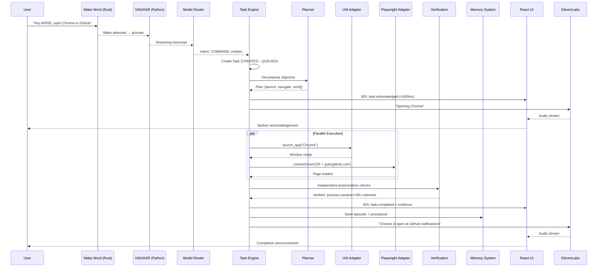

# ARISE — High-Level Architecture

## Architectural Vision

```
┌─────────────────────────────────────────────────────────────────────────────┐
│                        ARISE SYSTEM ARCHITECTURE                             │
│                                                                              │
│   "Model proposes what. Policy and verified capabilities decide how."       │
│                                                                              │
└─────────────────────────────────────────────────────────────────────────────┘
```

ARISE follows a **modular monolith** architecture: a single deployable unit (Tauri app) containing a Python FastAPI backend, Rust system layer, and React frontend, communicating via well-defined internal contracts. This avoids distributed system complexity while maintaining clear component boundaries for future extraction.

---

## Top-Level Component Diagram

```
┌─────────────────────────────────────────────────────────────────────────────────┐
│                              ARISE APPLICATION                                   │
│  ┌─────────────────────────────────────────────────────────────────────────┐    │
│  │                        TAURI 2 HOST PROCESS (Rust)                       │    │
│  │  ┌──────────┐ ┌──────────┐ ┌──────────┐ ┌──────────┐ ┌──────────┐      │    │
│  │  │  WebView2│ │  System  │ │ Credential│ │  Audio   │ │  Python  │      │    │
│  │  │  Window  │ │  Tray/   │ │  Manager  │ │  Engine  │ │  Manager │      │    │
│  │  │  (React) │ │  Shortcuts│ │  (WinCred)│ │  (cpal)  │ │  (uvicorn)│      │    │
│  │  └──────────┘ └──────────┘ └──────────┘ └──────────┘ └──────────┘      │    │
│  │        │            │            │            │            │            │    │
│  │        └────────────┴────────────┴────────────┴────────────┘            │    │
│  │                             │                                            │    │
│  │                    ┌────────▼────────┐                                  │    │
│  │                    │  Tauri Command  │                                  │    │
│  │                    │  & Event Bus    │                                  │    │
│  │                    └────────┬────────┘                                  │    │
│  └─────────────────────────────┼──────────────────────────────────────────┘    │
│                                │                                                │
│         ┌──────────────────────┼──────────────────────┐                        │
│         ▼                      ▼                      ▼                        │
│  ┌─────────────┐       ┌─────────────┐       ┌─────────────┐                  │
│  │  FRONTEND   │       │  BACKEND    │       │  ADAPTERS   │                  │
│  │  (React 18) │◄─────►│  (FastAPI)  │◄─────►│  (Python)   │                  │
│  │             │  WS   │             │  IPC  │             │                  │
│  │ • Dashboard │       │ • Task Eng  │       │ • UIA       │                  │
│  │ • Companion │       │ • Policy    │       │ • Playwright│                  │
│  │ • Voice UI  │       │ • Model Rtr │       │ • CV/OCR    │                  │
│  │ • Settings  │       │ • Agents    │       │ • FS/Shell  │                  │
│  └─────────────┘       └─────────────┘       └─────────────┘                  │
│         │                      │                      │                        │
│         └──────────────────────┼──────────────────────┘                        │
│                                ▼                                                │
│                    ┌─────────────────────┐                                     │
│                    │  PERSISTENCE LAYER  │                                     │
│                    │  • SQLite (WAL)     │                                     │
│                    │  • ChromaDB (embd)  │                                     │
│                    │  • File Artifacts   │                                     │
│                    │  • Win Cred Manager │                                     │
│                    └─────────────────────┘                                     │
└─────────────────────────────────────────────────────────────────────────────────┘
```

---

## Component Responsibilities

### 1. Tauri Host (Rust) — System Integration Layer

| Responsibility | Details |
|----------------|---------|
| **Process Supervision** | Launch/monitor Python backend (uvicorn), restart on crash, graceful shutdown |
| **WebView2 Management** | Create/maintain main window + floating companion window |
| **System Integration** | Global shortcuts (Alt+A), system tray, notifications, clipboard, file dialogs |
| **Credential Storage** | Windows Credential Manager (encrypt/decrypt secrets, zeroize) |
| **Audio I/O** | Low-latency capture/playback via `cpal` (WASAPI on Windows) |
| **Auto-Updater** | Signed MSI updates, staged installation, rollback on failure |
| **IPC Bridge** | Typed command/event channel between Rust ↔ Python ↔ Frontend |

**Key Rust Modules:**
```rust
// src-tauri/src/
├── main.rs              // Entry point, lifecycle, Python process manager
├── commands/            // Tauri #[command] handlers
│   ├── system.rs        // System info, monitoring, power
│   ├── credentials.rs   // WinCred store/retrieve/delete
│   ├── audio.rs         // cpal stream control, device enumeration
│   ├── automation.rs    // UIA/Win32 via windows-rs
│   ├── browser.rs       // Playwright CDP attach helper
│   └── window.rs        // Floating companion, full-screen toggle
├── events/              // Tauri Event emission (task progress, voice state)
├── python/              // Python subprocess management
│   ├── manager.rs       // Spawn, health check, restart, stdin/stdout piping
│   └── ipc.rs           // JSON-RPC over stdio or local socket
└── updater/             // Update check, download, verify, install, rollback
```

### 2. Python Backend (FastAPI) — Intelligence & Orchestration Layer

| Responsibility | Details |
|----------------|---------|
| **Task Engine** | 28-state lifecycle, checkpoint persistence, concurrency control |
| **Policy Engine** | Risk assessment (R0-R4), capability grants, approval workflows |
| **Model Router** | Provider-neutral, circuit breaker, fallback chain, privacy modes |
| **Multi-Agent Coordinator** | Decomposition, delegation, verification, conflict resolution |
| **Memory System** | 5 kinds (semantic, episodic, procedural, preference, working) |
| **Scheduler** | Recurring/one-shot tasks, deadlines, resource-aware |
| **Adapters** | Unified interface to UIA, Playwright, CV, FS, Shell, Providers |
| **Voice Pipeline** | Wake-word → VAD/ASR → Gemini Live → TTS orchestration |

**Key Python Modules:**
```python
# src/arise/
├── server.py            # FastAPI composition root, lifespan, middleware
├── config/
│   ├── settings.py      # Pydantic Settings, .env, secret refs
│   └── logging.py       # structlog config, rotation, audit sink
├── core/
│   ├── contracts.py     # Protocol interfaces (Ports)
│   ├── ports.py         # Abstract base classes for adapters
│   ├── runtime.py       # AppRuntime: DI container, component registry
│   ├── health.py        # Health checks, readiness, liveness
│   └── resources.py     # Resource quotas, allocation, monitoring
├── engine/
│   ├── tasks.py         # Task, TaskStatus (28 states), TaskContext
│   ├── engine.py        # TaskEngine: submit, execute, checkpoint, recover
│   ├── planner.py       # GatewayTaskPlanner: decompose, route, estimate
│   └── scheduler.py     # APScheduler integration, deadline mgmt
├── policy/
│   ├── engine.py        # PolicyEngine: evaluate, grant, approve, audit
│   ├── models.py        # RiskLevel, CapabilityGrant, ApprovalRequest
│   └── rules.py         # Default rules, user overrides, temporal conditions
├── models/
│   ├── router.py        # ModelRouter: select, circuit-break, fallback
│   ├── providers/       # Provider implementations
│   │   ├── gemini.py    # Gemini Live API (WebSocket)
│   │   ├── openai.py    # Realtime, Chat, Embeddings, TTS
│   │   ├── anthropic.py # Messages API
│   │   ├── nvidia_nim.py# NIM containers
│   │   └── local.py     # Ollama / LM Studio
│   └── registry.py      # Model capabilities, pricing, limits
├── agents/
│   ├── coordinator.py   # CentralCoordinator: understand, plan, delegate
│   ├── registry.py      # AgentRegistry: capabilities, permissions, health
│   ├── base.py          # BaseAgent: lifecycle, sandbox, communication
│   └── specialists/     # 11 specialist implementations
│       ├── research.py
│       ├── coding.py
│       ├── computer_use.py
│       ├── browser.py
│       ├── filesystem.py
│       ├── system.py
│       ├── communications.py
│       ├── creative.py
│       ├── memory.py
│       ├── projects.py
│       └── agent_factory.py
├── memory/
│   ├── system.py        # MemorySystem: 5 kinds, governance, consolidation
│   ├── stores/          # Backend implementations
│   │   ├── chroma.py    # ChromaDB collections per kind
│   │   ├── sqlite.py    # Episodic/procedural in SQLite FTS5
│   │   └── working.py   # In-memory with persistence
│   ├── retrieval.py     # Context-aware retrieval, reranking
│   └── consolidation.py # Scheduled summarization, conflict resolution
├── voice/
│   ├── pipeline.py      # VoicePipeline: wake → VAD → ASR → Live → TTS
│   ├── wake_word.py     # Porcupine integration
│   ├── vad_asr.py       # Sherpa-ONNX streaming
│   ├── gemini_live.py   # WebSocket client, barge-in, resumption
│   └── tts.py           # ElevenLabs / OpenAI fallback
├── adapters/
│   ├── registry.py      # AdapterRegistry: discover, validate, capability map
│   ├── windows_uia.py   # uiautomation-new + pywinauto hybrid
│   ├── browser_playwright.py # Playwright CDP attach, trace, stealth
│   ├── perception.py    # Screenshot, OCR (Tesseract/Paddle), Vision API
│   ├── filesystem.py    # Path ops, watch, search, metadata
│   ├── shell.py         # Process, cmd, env, shortcuts
│   ├── brave_research.py# Brave Search API + Playwright fallback
│   ├── audio_local.py   # cpal via Tauri command bridge
│   └── diagnostics.py   # Health, benchmarks, self-test
└── api/
    ├── routes/          # REST endpoints
    │   ├── tasks.py
    │   ├── agents.py
    │   ├── memory.py
    │   ├── projects.py
    │   ├── voice.py
    │   ├── system.py
    │   └── config.py
    └── websocket.py     # Real-time: task progress, voice state, agent activity
```

### 3. Frontend (React 18 + TypeScript) — Presentation Layer

| Responsibility | Details |
|----------------|---------|
| **Dashboard** | Full-screen command center: tasks, agents, projects, system, memory |
| **Floating Companion** | Always-accessible orb: state indicators, quick actions, voice visualizer |
| **Voice UI** | Waveform, transcript, language indicator, mute control |
| **Settings** | Providers, permissions, shortcuts, themes, backup, updates |
| **Real-time Sync** | WebSocket + Tauri events for live updates |

**Component Structure:**
```typescript
// src/frontend/src/
├── main.tsx                 // Entry, providers, router
├── App.tsx                  // Root layout, WebSocket connection
├── components/
│   ├── layout/
│   │   ├── Dashboard.tsx    // Full-screen grid layout
│   │   ├── FloatingCompanion.tsx // Draggable orb, state machine
│   │   └── Shell.tsx        // Shared chrome, notifications
│   ├── dashboard/
│   │   ├── TaskBoard.tsx    // Kanban: queued/running/waiting/done
│   │   ├── AgentPanel.tsx   // Specialist status, logs, evidence
│   │   ├── ProjectView.tsx  // Roadmap, milestones, artifacts
│   │   ├── SystemMonitor.tsx// CPU, RAM, GPU, VRAM, battery
│   │   ├── MemoryExplorer.tsx// Semantic/episodic/procedural browser
│   │   ├── EvidenceLog.tsx  // Timeline, screenshots, verification
│   │   └── ProviderStatus.tsx// Model health, latency, costs
│   ├── voice/
│   │   ├── VoiceVisualizer.tsx // Waveform, frequency bars
│   │   ├── Transcript.tsx   // Live + history, corrections
│   │   ├── LanguageBadge.tsx // EN/TE/Code-switch indicator
│   │   └── MuteToggle.tsx   // Immediate mute, sleep command
│   ├── settings/
│   │   ├── ProvidersTab.tsx // API keys (via Tauri cred cmd)
│   │   ├── PermissionsTab.tsx// Risk rules, capability grants
│   │   ├── ShortcutsTab.tsx // Global shortcut editor
│   │   ├── ThemeTab.tsx     // CSS custom properties
│   │   └── BackupTab.tsx    // Schedule, verify, export
│   └── common/
│       ├── Button.tsx
│       ├── Card.tsx
│       ├── Modal.tsx
│       ├── Tooltip.tsx
│       └── Loading.tsx
├── hooks/
│   ├── useTasks.ts
│   ├── useAgents.ts
│   ├── useVoice.ts
│   ├── useWebSocket.ts
│   └── useTauriCommands.ts
├── state/
│   ├── taskStore.ts         // Zustand: tasks, filters, selection
│   ├── agentStore.ts        // Agents, status, communications
│   ├── voiceStore.ts        // State, transcript, audio level
│   ├── uiStore.ts           // Layout, theme, companion position
│   └── settingsStore.ts     // Persisted via Tauri plugin-store
├── services/
│   ├── api.ts               // REST client (axios/fetch)
│   ├── websocket.ts         // WS connection, reconnection, types
│   └── tauri.ts             // Tauri command wrappers, events
└── styles/
    ├── globals.css          // CSS custom properties, reset
    ├── theme.css            // Light/dark, high contrast, reduced motion
    ├── layout.css           // Grid, companion positioning
    └── components.css       // Component-scoped styles
```

---

## Communication Patterns

### 1. Frontend ↔ Backend: WebSocket + REST

```
┌─────────────┐                    ┌─────────────┐
│  FRONTEND   │                    │  BACKEND    │
│  (React)    │                    │  (FastAPI)  │
└──────┬──────┘                    └──────┬──────┘
       │                                  │
       │  REST: CRUD, config, bulk ops    │
       ├──────────────────────────────────►│
       │                                  │
       │  WebSocket: real-time events     │
       │  • task.state_changed            │
       │  • agent.activity                │
       │  • voice.state                   │
       │  • system.metrics                │
       │  • memory.updated                │
       │  • notification                  │
       ◄──────────────────────────────────┤
       │                                  │
```

**WebSocket Message Format:**
```json
{
  "type": "task.state_changed",
  "timestamp": "2026-11-10T10:30:45.123Z",
  "payload": {
    "task_id": "task_abc123",
    "previous_state": "RUNNING",
    "new_state": "VERIFYING",
    "progress": 0.85,
    "evidence_ref": "evidence_20261110_103045_001"
  }
}
```

### 2. Backend ↔ Tauri (Rust): JSON-RPC over Stdio / Local Socket

```
┌─────────────┐                    ┌─────────────┐
│  PYTHON     │                    │  RUST       │
│  BACKEND    │                    │  (TAURI)    │
└──────┬──────┘                    └──────┬──────┘
       │                                  │
       │  JSON-RPC 2.0 over stdio         │
       │  • system.get_info               │
       │  • credentials.store             │
       │  • credentials.get               │
       │  • audio.start_capture           │
       │  • audio.stop_capture            │
       │  • uia.find_element              │
       │  • browser.attach_cdp            │
       │  • window.show_companion         │
       ├──────────────────────────────────►│
       │                                  │
       │  Response / Event                │
       ◄──────────────────────────────────┤
```

**Example Command:**
```json
// Python → Rust
{
  "jsonrpc": "2.0",
  "method": "credentials.get",
  "params": {"service": "ARISE", "account": "gemini_api_key"},
  "id": 42
}

// Rust → Python
{
  "jsonrpc": "2.0",
  "result": {"password": "sk-..."},
  "id": 42
}
```

### 3. Tauri ↔ Frontend: Tauri Commands + Events

```
┌─────────────┐                    ┌─────────────┐
│  FRONTEND   │                    │  RUST       │
│  (React)    │                    │  (TAURI)    │
└──────┬──────┘                    └──────┬──────┘
       │                                  │
       │  invoke("command_name", args)    │
       │  • store_credential              │
       │  • get_credential                │
       │  • launch_app                    │
       │  • show_companion                │
       │  • set_global_shortcut           │
       ├──────────────────────────────────►│
       │                                  │
       │  Promise<Result>                 │
       ◄──────────────────────────────────┤
       │                                  │
       │  listen("event_name", handler)   │
       │  • task_progress                 │
       │  • voice_state                   │
       │  • system_alert                  │
       ◄──────────────────────────────────┤
```

---

## Data Flow: End-to-End Scenarios

### Scenario A: Voice Command → Desktop Action

```
USER: "Hey ARISE, open Chrome and go to my GitHub notifications"
                │
                ▼
┌──────────────────────────────────────────────────────────────────────┐
│ 1. WAKE WORD (Rust/cpal + Porcupine)                                 │
│    - Always-on keyword spotting on audio stream                      │
│    - Match: "Hey ARISE" → trigger VAD/ASR activation                 │
└──────────────────────────────────────────────────────────────────────┘
                │
                ▼
┌──────────────────────────────────────────────────────────────────────┐
│ 2. VAD + STREAMING ASR (Python/Sherpa-ONNX)                          │
│    - Voice Activity Detection: speech start/end boundaries           │
│    - Incremental transcript: "open Chrome" → "open Chrome and..."    │
│    - Final transcript emitted on silence > 500ms                     │
└──────────────────────────────────────────────────────────────────────┘
                │
                ▼
┌──────────────────────────────────────────────────────────────────────┐
│ 3. INTENT CLASSIFICATION (FastAPI / Model Router)                    │
│    - Route to lightweight model (gemini-2.5-flash)                   │
│    - Output: {intent: "COMMAND", entities: {app: "Chrome",          │
│      action: "navigate", url: "github.com/notifications"}}           │
│    - Policy check: R1 (local write - launch app, navigate)           │
└──────────────────────────────────────────────────────────────────────┘
                │
                ▼
┌──────────────────────────────────────────────────────────────────────┐
│ 4. TASK CREATION & PLANNING (TaskEngine + Planner)                   │
│    - Create Task {type: "desktop_control", priority: "normal"}       │
│    - State: CREATED → QUEUED → UNDERSTANDING → PLANNING              │
│    - Planner decomposes:                                             │
│      Step 1: launch_app("Chrome")  [UIA adapter]                     │
│      Step 2: wait_window_ready("Chrome", timeout=10s)                │
│      Step 3: browser.navigate("https://github.com/notifications")    │
│              [Playwright CDP attach to existing profile]             │
│      Step 4: verify_page_loaded("GitHub", selectors)                 │
└──────────────────────────────────────────────────────────────────────┘
                │
                ▼
┌──────────────────────────────────────────────────────────────────────┐
│ 5. IMMEDIATE ACKNOWLEDGEMENT (<500ms)                                │
│    - Backend → WebSocket: task.created + task.acknowledged           │
│    - Frontend: task card appears, FloatingCompanion: LISTENING→THINKING│
│    - Voice: TTS "Opening Chrome" (ElevenLabs Flash, ~75ms TTFA)      │
└──────────────────────────────────────────────────────────────────────┘
                │
                ▼
┌──────────────────────────────────────────────────────────────────────┐
│ 6. EXECUTION (Parallel Adapters)                                     │
│    ┌────────────────────────────────────────────────────────────┐    │
│    │ UIA ADAPTER (uiautomation-new)                             │    │
│    │ • Find Chrome window or launch via ShellExecute            │    │
│    │ • Wait for main window: WindowControl(Name="Chrome")      │    │
│    │ • SetForeground, verify process exists                     │    │
│    └────────────────────────────────────────────────────────────┘    │
│    ┌────────────────────────────────────────────────────────────┐    │
│    │ PLAYWRIGHT ADAPTER (CDP attach)                            │    │
│    │ • connectOverCDP to existing Edge/Chrome debug port        │    │
│    │ • page.goto("https://github.com/notifications")            │    │
│    │ • wait_for_load_state("networkidle")                       │    │
│    │ • verify: page.locator('[data-tab-item="notifications"]').is_visible()│    │
│    └────────────────────────────────────────────────────────────┘    │
└──────────────────────────────────────────────────────────────────────┘
                │
                ▼
┌──────────────────────────────────────────────────────────────────────┐
│ 7. VERIFICATION (Independent Postcondition Checks)                   │
│    - Desktop: process "chrome.exe" running, window focused           │
│    - Browser: URL matches, target element visible, no console errors │
│    - Evidence: screenshot (PNG), timestamp, adapter logs, permissions│
└──────────────────────────────────────────────────────────────────────┘
                │
                ▼
┌──────────────────────────────────────────────────────────────────────┐
│ 8. COMPLETION & MEMORY                                               │
│    - Task state: RUNNING → VERIFYING → COMPLETED                     │
│    - WebSocket: task.completed + evidence_ref                        │
│    - Frontend: task card → green, evidence link, FloatingCompanion→SPEAKING│
│    - Voice: "Chrome is open at your GitHub notifications"           │
│    - Memory:                                                         │
│      • Episodic: "User asked to open Chrome to GitHub notifications" │
│      • Procedural: "Chrome → github.com/notifications" (for replay)  │
│      • Semantic: "GitHub notifications page structure"               │
└──────────────────────────────────────────────────────────────────────┘
```

### Scenario B: Complex Multi-Agent Task (Code Project)

```
USER: "Build a React dashboard for my API metrics with authentication"
                │
                ▼
┌──────────────────────────────────────────────────────────────────────┐
│ COORDINATOR AGENT                                                    │
│ 1. Understand objective → decompose into sub-tasks                   │
│ 2. Create child agents with scoped permissions:                      │
│    • Research Agent: "best React dashboard libs 2026, auth patterns" │
│    • Coding Agent: "scaffold Vite+React+TS, auth context, API client"│
│    • Computer Agent: "create project folder, init git, install deps" │
│    • Browser Agent: "verify dev server runs, check console errors"   │
│ 3. Define dependencies: Research → Coding → Computer → Browser       │
│ 4. Set checkpoint after each phase                                   │
└──────────────────────────────────────────────────────────────────────┘
                │
                ▼
┌──────────────────────────────────────────────────────────────────────┐
│ PARALLEL EXECUTION WITH COORDINATION                                 │
│                                                                      │
│ RESEARCH AGENT (R0 - read only)                                     │
│ ├─ Search web (Brave API + Playwright fallback)                     │
│ ├─ Cross-source verify: 3+ independent sources                      │
│ ├─ Output: structured report with citations                         │
│ └─ Evidence: search queries, sources, timestamps                    │
│                                                                      │
│ CODING AGENT (R1 - local write, scoped to project folder)           │
│ ├─ Read research report (shared via coordinator)                    │
│ ├─ Generate task-specific prompt (conventions, exact requirements)  │
│ ├─ Write files via filesystem adapter                                │
│ ├─ Run lint/typecheck via shell adapter                             │
│ └─ Evidence: files created, test output, git diff                   │
│                                                                      │
│ COMPUTER AGENT (R1 - process, filesystem)                           │
│ ├─ mkdir project, git init, npm install                             │
│ ├─ Verify: package.json, node_modules, .git                         │
│ └─ Evidence: process output, directory tree                         │
│                                                                      │
│ BROWSER AGENT (R1 - browser navigate)                               │
│ ├─ Playwright CDP attach to dev server (localhost:5173)             │
│ ├─ Navigate, verify: no console errors, auth flow works             │
│ └─ Evidence: screenshots, network log, console log                  │
└──────────────────────────────────────────────────────────────────────┘
                │
                ▼
┌──────────────────────────────────────────────────────────────────────┐
│ COORDINATOR VERIFICATION & INTEGRATION                               │
│ 1. Collect evidence from all agents                                  │
│ 2. Independent verification agent reviews:                           │
│    - Code compiles, tests pass                                       │
│    - Dev server runs, dashboard renders                             │
│    - Auth flow functional                                            │
│ 3. Resolve conflicts (e.g., coding vs research disagreement)         │
│ 4. Synthesize final report with all evidence                         │
└──────────────────────────────────────────────────────────────────────┘
                │
                ▼
┌──────────────────────────────────────────────────────────────────────┐
│ COMPLETION                                                           │
│ - Parent task: COMPLETED                                             │
│ - Artifacts linked: project folder, running dev server URL           │
│ - Memory: project roadmap updated, procedural knowledge stored       │
│ - Voice: "Dashboard is ready at localhost:5173 with JWT auth"       │
└──────────────────────────────────────────────────────────────────────┘
```

---

## Deployment Topology

### Single-User Windows Desktop (Target)

```
┌─────────────────────────────────────────────────────────────────┐
│                    USER'S WINDOWS 11 MACHINE                     │
│                                                                  │
│  ┌─────────────────────────────────────────────────────────┐    │
│  │                 ARISE INSTALLATION                        │    │
│  │  C:\Program Files\ARISE\                                  │    │
│  │  ├── arise.exe              # Tauri binary (signed)       │    │
│  │  ├── python/                # Embedded Python 3.12+       │    │
│  │  │   ├── python.exe                                              │
│  │  │   ├── python312.dll                                         │
│  │  │   └── Lib/site-packages/  # All deps (vendored)            │    │
│  │  ├── resources/             # Assets, WASM modules            │    │
│  │  └── webview/               # WebView2 loader (fixed version)  │    │
│  └─────────────────────────────────────────────────────────┘    │
│                                                                  │
│  ┌─────────────────────────────────────────────────────────┐    │
│  │                 USER DATA (AppData)                       │    │
│  │  %LOCALAPPDATA%\ARISE\                                    │    │
│  │  ├── memory/                                              │    │
│  │  │   ├── chroma/            # ChromaDB collections        │    │
│  │  │   └── sqlite/            # tasks.db, projects.db       │    │
│  │  ├── checkpoints/           # Task checkpoints (JSONL)     │    │
│  │  ├── artifacts/             # Generated files, screenshots │    │
│  │  ├── logs/                  # Structured logs (rotating)   │    │
│  │  ├── backups/               # Scheduled backups (zip)      │    │
│  │  └── config/                # settings.json, keyring refs  │    │
│  └─────────────────────────────────────────────────────────┘    │
│                                                                  │
│  ┌─────────────────────────────────────────────────────────┐    │
│  │              WINDOWS CREDENTIAL MANAGER                    │    │
│  │  Target: ARISE                                            │    │
│  │  ├── gemini_api_key                                        │    │
│  │  ├── openai_api_key                                        │    │
│  │  ├── elevenlabs_api_key                                    │    │
│  │  └── ...                                                   │    │
│  └─────────────────────────────────────────────────────────┘    │
│                                                                  │
└─────────────────────────────────────────────────────────────────┘
```

### Process Tree (Runtime)

```
arise.exe (Tauri, Rust)
├── WebView2 (Main Window - React Dashboard)
├── WebView2 (Floating Companion - optional)
├── python.exe (uvicorn, FastAPI backend)
│   ├── ThreadPool: TaskEngine workers (configurable, default 4)
│   ├── ThreadPool: Adapter I/O (Playwright, UIA, HTTP)
│   ├── AsyncIO Event Loop: WebSocket, Model Router, Agents
│   └── Subprocesses: Playwright browsers (Chromium/Firefox/WebKit)
├── cpal audio threads (WASAPI capture/render)
└── System Tray / Global Shortcut hooks
```

---

## Scalability & Extensibility

### Horizontal Scaling (Future)

| Component | Current | Future Path |
|-----------|---------|-------------|
| **Task Execution** | In-process thread pool | Extract to worker pool (separate process, gRPC) |
| **Model Inference** | API calls | Local inference server (Ollama/NIM) + router |
| **Browser Automation** | Local Playwright | Browser pool (Playwright Grid / browser-use cloud) |
| **Memory/Vector Search** | Embedded ChromaDB | Qdrant/LanceDB server + client |
| **Multi-Agent** | In-process | Agent runtime (NATS/gRPC) for distribution |

### Plugin/Extension Points (AR-SKILLS-004)

```
┌─────────────────────────────────────────────────────────────────┐
│                      EXTENSION ARCHITECTURE                      │
├─────────────────────────────────────────────────────────────────┤
│                                                                  │
│  CORE (Immutable)                    EXTENSIONS (Pluggable)     │
│  ┌─────────────────────┐             ┌─────────────────────┐   │
│  │ • Task Engine       │◄────────────│ • Custom Adapters   │   │
│  │ • Policy Engine     │  Implements │   (new apps, APIs)  │   │
│  │ • Model Router      │  Ports      │ • Specialist Agents │   │
│  │ • Memory System     │             │   (domain-specific) │   │
│  │ • Voice Pipeline    │             │ • Skill Packs       │   │
│  │ • Coordinator       │             │   (procedural mem)  │   │
│  └─────────────────────┘             └─────────────────────┘   │
│         ▲                                    ▲                   │
│         │         ADAPTER REGISTRY           │                   │
│         │  (discovers, validates, maps       │                   │
│         │   capabilities to permissions)     │                   │
│         └────────────────────────────────────┘                   │
│                                                                  │
│  Sandbox Options (ADR-005):                                      │
│  • WASM (wasmtime) - strong isolation, polyglot                 │
│  • Subprocess - simple, language-agnostic, heavier              │
│  • In-process - fastest, requires trust, Rust/Python only       │
│                                                                  │
└─────────────────────────────────────────────────────────────────┘
```

---

## Reliability Patterns

### Failure Domains & Isolation

```
┌─────────────────────────────────────────────────────────────────┐
│                      FAILURE ISOLATION                           │
├─────────────────────────────────────────────────────────────────┤
│                                                                  │
│  TAURI HOST (Rust)          ←  CRITICAL: never crashes          │
│  ├─ Supervises Python       │  Restart on crash, preserve state │
│  ├─ Manages WebView2        │  Recreate window, restore session │
│  └─ Holds Credentials       │  Never lost, OS-protected         │
│                                                                  │
│  PYTHON BACKEND             ←  RESILIENT: graceful degradation  │
│  ├─ Task Engine             │  Checkpoint every step, recover   │
│  ├─ Model Router            │  Circuit breaker, fallback chain  │
│  ├─ Adapters                │  Independent, retry with backoff  │
│  └─ Agents                  │  Sandbox, independent verification│
│                                                                  │
│  FRONTEND (React)           ←  EPHEMERAL: stateless, recreatable│
│  ├─ WebSocket reconnection  │  Exponential backoff, max 5 retries│
│  ├─ State from stores       │  Persisted via Tauri store        │
│  └─ Companion window        │  Recreate from Tauri command      │
│                                                                  │
└─────────────────────────────────────────────────────────────────┘
```

### Checkpoint & Recovery (AR-CORE-011)

```python
# Checkpoint at every state transition
@dataclass
class TaskCheckpoint:
    task_id: str
    state: TaskStatus
    step_index: int
    context: TaskContext          # Serialized: variables, refs, partial results
    evidence_refs: list[str]      # Links to evidence store
    timestamp: datetime
    agent_id: str | None          # If delegated
    
# Recovery strategy
RECOVERY_STRATEGIES = {
    TaskStatus.PLANNING: "restart_planning",      # Re-plan with current context
    TaskStatus.READY: "resume_execution",         # Continue from step_index
    TaskStatus.RUNNING: "retry_step",             # Retry current step (idempotent)
    TaskStatus.WAITING_APPROVAL: "re_prompt",     # Re-request approval
    TaskStatus.WAITING_RESOURCE: "requeue",       # Requeue when resource free
    TaskStatus.VERIFYING: "re_verify",            # Re-run verification
}
```

---

## Security Boundaries

```
┌─────────────────────────────────────────────────────────────────┐
│                      TRUST BOUNDARIES                            │
├─────────────────────────────────────────────────────────────────┤
│                                                                  │
│  TRUSTED (TCB - Trusted Computing Base)                         │
│  ┌─────────────────────────────────────────────────────────┐   │
│  │ • Tauri Rust binary (signed, verified)                  │   │
│  │ • Windows Credential Manager (OS)                       │   │
│  │ • WebView2 (Microsoft signed)                           │   │
│  │ • Python stdlib + vetted deps (pinned, hashed)          │   │
│  │ • Policy Engine (authoritative decisions)               │   │
│  └─────────────────────────────────────────────────────────┘   │
│                              │                                   │
│              Capability Grants / Policy Decisions               │
│                              ▼                                   │
│  SEMI-TRUSTED                                                        │
│  ┌─────────────────────────────────────────────────────────┐   │
│  │ • Python Backend (FastAPI, adapters, agents)            │   │
│  │ • Model Router (provider selection, not execution)      │   │
│  │ • Memory System (storage, retrieval)                    │   │
│  │ • Task Engine (orchestration, not action)               │   │
│  └─────────────────────────────────────────────────────────┘   │
│                              │                                   │
│              Scoped Permissions / Sandbox                       │
│                              ▼                                   │
│  UNTRUSTED / EXTERNAL                                               │
│  ┌─────────────────────────────────────────────────────────┐   │
│  │ • AI Model Providers (Gemini, OpenAI, Anthropic, etc.)  │   │
│  │ • Web Content (browsers, search results, downloads)     │   │
│  │ • User Documents (arbitrary files, macros, scripts)     │   │
│  │ • Third-party Applications (UIA targets)                │   │
│  │ • Plugin/Skill Code (WASM/subprocess)                   │   │
│  └─────────────────────────────────────────────────────────┘   │
│                                                                  │
│  DEFENSES:                                                       │
│  • Prompt injection: Input sanitization, instruction hierarchy  │
│  • Malicious web: Playwright sandbox, no arbitrary JS exec      │
│  • Credential theft: Never in memory, WinCred only              │
│  • Agent escape: Scoped capabilities, coordinator mediation     │
│  • Data exfiltration: No external telemetry, local-first        │
│                                                                  │
└─────────────────────────────────────────────────────────────────┘
```

---

## Observability

### Structured Logging (All Layers)

```json
// Example log entry (structlog JSON)
{
  "timestamp": "2026-11-10T10:30:45.123456Z",
  "level": "INFO",
  "logger": "arise.engine.engine",
  "event": "task_state_transition",
  "task_id": "task_abc123",
  "previous_state": "PLANNING",
  "new_state": "READY",
  "plan_steps": 4,
  "estimated_duration_ms": 15000,
  "agent_id": "coordinator",
  "trace_id": "trace_xyz789",
  "span_id": "span_001"
}
```

### Metrics (Prometheus-compatible, via structured logs)

| Metric | Type | Labels | Description |
|--------|------|--------|-------------|
| `arise_task_duration_seconds` | Histogram | task_type, status | End-to-end task latency |
| `arise_task_state_transitions_total` | Counter | from_state, to_state | State machine transitions |
| `arise_model_requests_total` | Counter | provider, model, status | Model API calls |
| `arise_model_latency_seconds` | Histogram | provider, model | Model response time |
| `arise_adapter_calls_total` | Counter | adapter, operation, status | Adapter invocations |
| `arise_memory_query_seconds` | Histogram | kind, operation | Vector/relational query time |
| `arise_voice_pipeline_latency_seconds` | Histogram | stage | Wake→VAD→ASR→Live→TTS |
| `arise_policy_evaluations_total` | Counter | risk_level, decision | Policy checks |
| `arise_active_tasks` | Gauge | — | Concurrent tasks running |
| `arise_system_resources` | Gauge | cpu, ram, gpu, vram | Resource utilization |

### Health Endpoints

```
GET /health/live        # Liveness: process alive, no deadlock
GET /health/ready       # Readiness: DB connected, adapters healthy, model reachable
GET /health/components  # Component-level: each adapter, provider, store status
```

---

## Open Architectural Decisions (ADRs)

| ADR | Title | Status | Decision Needed |
|-----|-------|--------|-----------------|
| ADR-001 | Task Queue Persistence | 🔄 Research | SQLite WAL vs Redis vs Custom WAL |
| ADR-002 | Agent Communication Protocol | 🔄 Research | In-process channels vs gRPC vs NATS |
| ADR-003 | Memory Consolidation Scheduler | 🔄 Research | APScheduler cron vs event-driven |
| ADR-004 | Evidence Storage Format | 🔄 Research | JSONL+SQLite vs Parquet vs Custom |
| ADR-005 | Plugin/Skill Sandbox | 🔄 Research | wasmtime (WASM) vs subprocess vs in-process |
| ADR-006 | Real-Time Audio Transport | 🔄 Research | cpal→Tauri→WebAudio vs WebRTC data channel |
| ADR-007 | Multi-Agent State Sync | 🔄 Research | Event sourcing vs CRDT vs Central Coordinator |
| ADR-008 | Configuration Hot-Reload | 🔄 Research | File watch + SIGHUP vs polling vs push |
| ADR-009 | Backup Encryption | 🔄 Research | Age (Rust) vs GPG vs Windows DPAPI |
| ADR-010 | Telemetry Opt-In | 🔄 Design | What, how, where (local-only default) |

---

## Appendix: Sequence Diagram (Voice Command)

