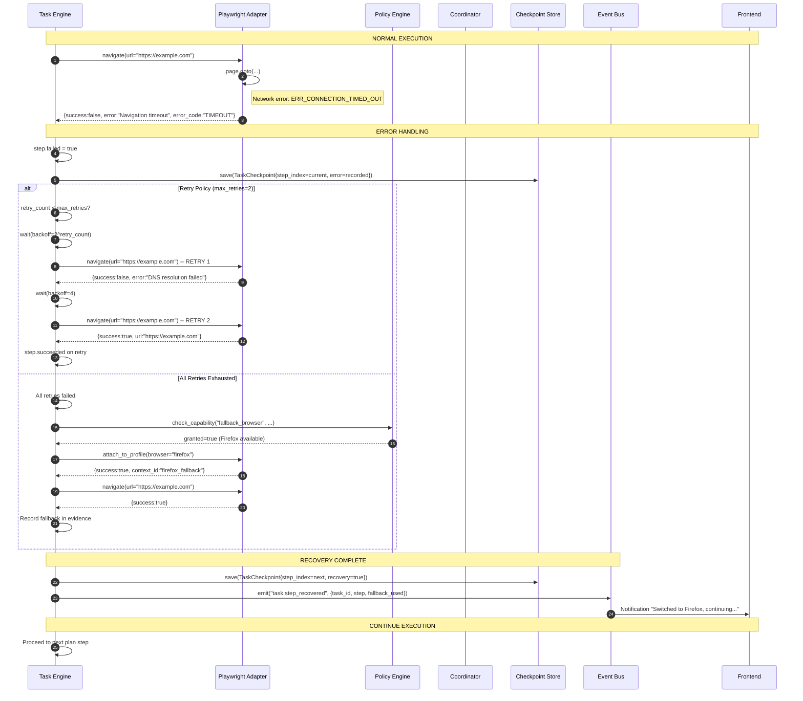
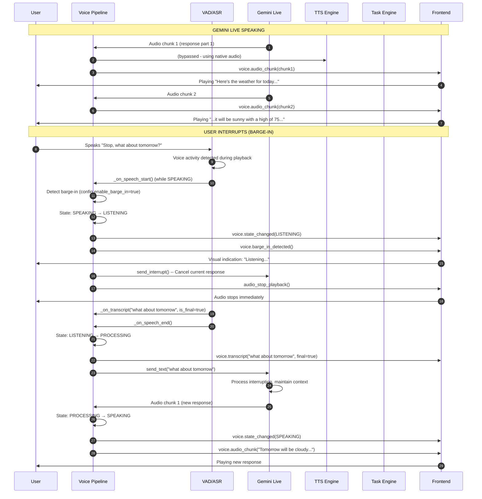
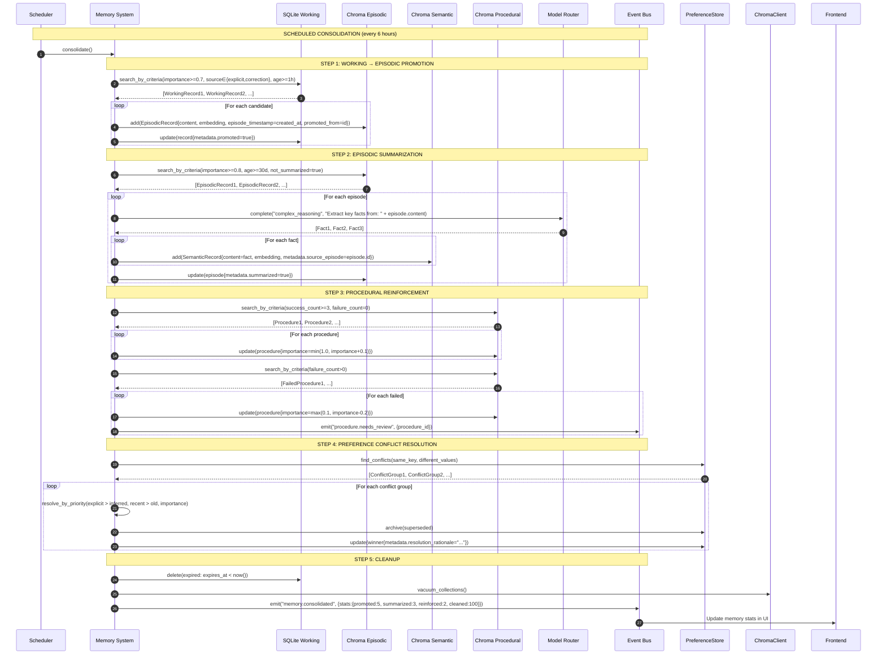
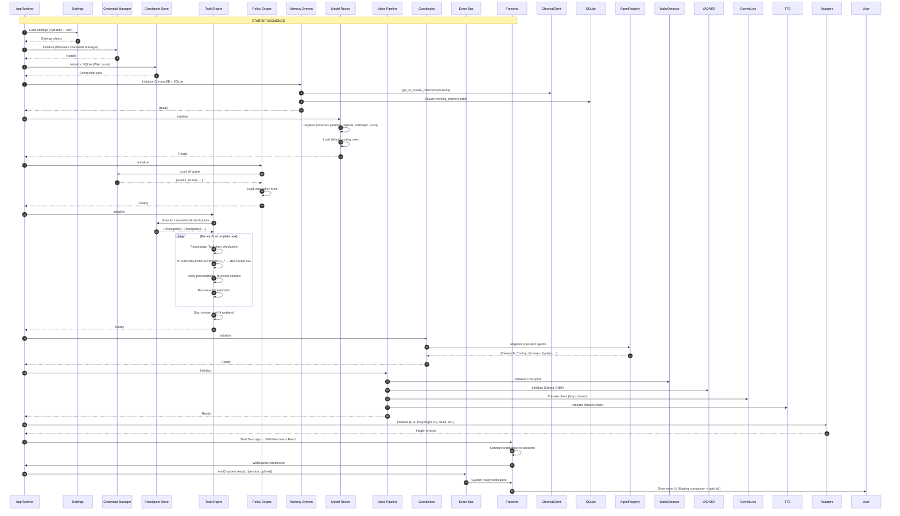
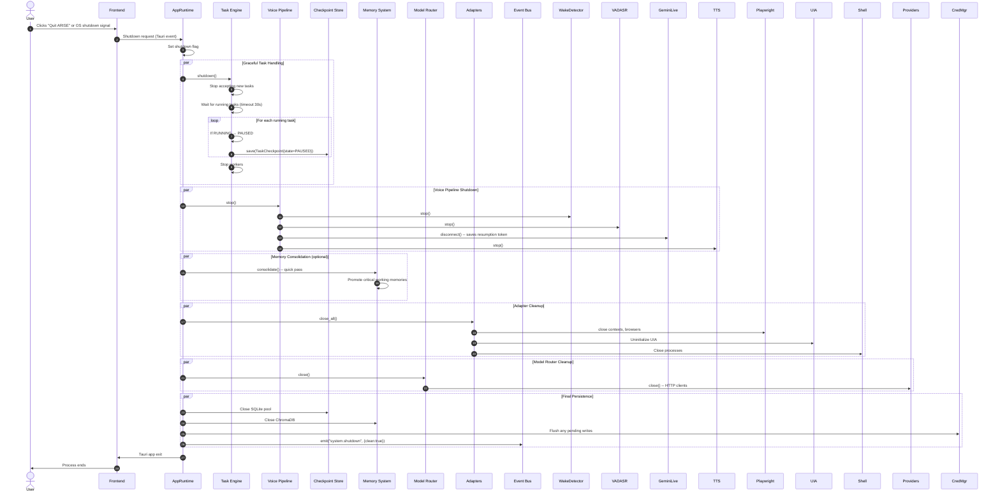

# ARISE — Sequence Diagrams

## Overview

This document provides detailed sequence diagrams for the critical end-to-end flows in ARISE. Each diagram shows component interactions, message sequences, timing considerations, and error handling paths.

---

## 1. Voice Command: "Hey ARISE, open Chrome and go to GitHub"

```mermaid
sequenceDiagram
    autonumber
    actor User
    participant Frontend as Frontend (React)
    participant Voice as Voice Pipeline
    participant Wake as Wake Detector
    participant VAD as VAD/ASR
    participant Router as Model Router
    participant TaskEngine as Task Engine
    participant Policy as Policy Engine
    participant Coordinator as Coordinator
    participant UIA as Windows UIA Adapter
    participant Playwright as Playwright Adapter
    participant Checkpoint as Checkpoint Store
    participant Events as Event Bus

    Note over User,Events: VOICE ACTIVATION PHASE
    User->>Wake: Speaks "Hey ARISE"
    Wake->>Wake: Porcupine detects wake word
    Wake->>Voice: _on_wake_detected("Hey ARISE")
    Voice->>Voice: State: DORMANT → DETECTING
    Voice->>VAD: Start listening
    Voice->>Voice: State: DETECTING → LISTENING
    Voice->>Frontend: voice.state_changed(LISTENING)
    Frontend->>User: Shows listening indicator

    Note over User,Events: SPEECH RECOGNITION PHASE
    User->>VAD: Speaks "open Chrome and go to GitHub"
    VAD->>VAD: Voice activity detected
    VAD->>Voice: _on_speech_start()
    VAD->>Voice: _on_transcript("open Chrome...", is_final=false)
    Voice->>Frontend: voice.transcript("open Chrome...", partial=true)
    Frontend->>User: Shows partial transcript
    VAD->>Voice: _on_transcript("open Chrome and go to GitHub", is_final=true)
    VAD->>Voice: _on_speech_end()
    Voice->>Voice: State: LISTENING → PROCESSING
    Voice->>Frontend: voice.transcript("open Chrome...", partial=false)
    Voice->>Frontend: voice.state_changed(PROCESSING)

    Note over User,Events: INTENT CLASSIFICATION & TASK CREATION
    Voice->>Router: complete("intent_classification", messages=[user_text])
    Router->>Router: Select model (gemini-2.5-flash)
    Router->>Gemini: GenerateContent(intent_prompt + user_text)
    Gemini-->>Router: {intent: "desktop_control", entities: {app: "Chrome", action: "navigate", url: "github.com"}}
    Router-->>Voice: IntentClassification result
    Voice->>TaskEngine: submit(Task{type:"desktop_control", objective:"open Chrome and go to GitHub"})
    TaskEngine->>TaskEngine: Create task, status=CREATED
    TaskEngine->>Checkpoint: save(TaskCheckpoint{task_id, state=CREATED})
    TaskEngine->>Events: emit("task.created", task)
    Events->>Frontend: task.created notification
    Frontend->>User: Shows task started

    Note over User,Events: POLICY ASSESSMENT & PLANNING
    TaskEngine->>Policy: assess_risk("open Chrome and go to GitHub", intent)
    Policy->>Policy: Match rules → R1 (local write)
    Policy->>Policy: Required capabilities: [ui.click, ui.type, browser.navigate]
    Policy->>Policy: Check existing grants
    Policy-->>TaskEngine: RiskAssessment{R1, capabilities, requires_approval=false}
    TaskEngine->>TaskEngine: Transition: CREATED → QUEUED → UNDERSTANDING
    TaskEngine->>Planner: create_plan(task)
    Planner->>Planner: Decompose into steps
    Planner-->>TaskEngine: ExecutionPlan{
      steps: [
        {id:"1", type:ADAPTER_CALL, adapter:"windows_uia", operation:"launch_app", params:{app:"Chrome"}},
        {id:"2", type:ADAPTER_CALL, adapter:"windows_uia", operation:"wait_for_window", params:{title:"Chrome"}},
        {id:"3", type:ADAPTER_CALL, adapter:"playwright", operation:"attach_to_profile", params:{browser:"chromium"}},
        {id:"4", type:ADAPTER_CALL, adapter:"playwright", operation:"navigate", params:{url:"https://github.com"}}
      ]
    }
    TaskEngine->>Checkpoint: save(TaskCheckpoint{state=PLANNING, step_index=0})
    TaskEngine->>TaskEngine: Transition: PLANNING → PLAN_APPROVED → READY

    Note over User,Events: EXECUTION PHASE
    TaskEngine->>TaskEngine: Transition: READY → RUNNING
    TaskEngine->>Checkpoint: save(TaskCheckpoint{state=RUNNING, step_index=0})
    
    par Step 1: Launch Chrome
        TaskEngine->>UIA: launch_app("Chrome")
        UIA->>UIA: pywinauto.Application.start("chrome.exe")
        UIA->>UIA: Wait for main window (10s timeout)
        UIA-->>TaskEngine: {success:true, process_id:1234, window_handle:0xABCD}
        TaskEngine->>TaskEngine: Record step result
        TaskEngine->>Checkpoint: save(TaskCheckpoint{step_index=1})
    end
    
    par Step 2: Verify Chrome window
        TaskEngine->>UIA: find_window(title="Chrome")
        UIA->>UIA: uiautomation.WindowControl(Name="Chrome")
        UIA-->>TaskEngine: {found:true, handle:0xABCD, rect:{...}}
        TaskEngine->>TaskEngine: Record step result
        TaskEngine->>Checkpoint: save(TaskCheckpoint{step_index=2})
    end
    
    par Step 3: Attach Playwright to Chrome
        TaskEngine->>Playwright: attach_to_profile(browser="chromium", channel="chrome")
        Playwright->>Playwright: Launch persistent context with Chrome profile
        Playwright->>Playwright: Start tracing
        Playwright-->>TaskEngine: {success:true, context_id:"default"}
        TaskEngine->>TaskEngine: Record step result
        TaskEngine->>Checkpoint: save(TaskCheckpoint{step_index=3})
    end
    
    par Step 4: Navigate to GitHub
        TaskEngine->>Playwright: navigate(url="https://github.com")
        Playwright->>Playwright: page.goto("https://github.com", wait_until="networkidle")
        Playwright-->>TaskEngine: {success:true, url:"https://github.com/", title:"GitHub"}
        TaskEngine->>TaskEngine: Record step result
        TaskEngine->>Checkpoint: save(TaskCheckpoint{step_index=4})
    end

    Note over User,Events: VERIFICATION & COMPLETION
    TaskEngine->>TaskEngine: Transition: RUNNING → WAITING_VERIFICATION
    TaskEngine->>Verifier: verify_completion(task)
    Verifier->>Verifier: Check expected evidence for each step
    Verifier->>Verifier: Step 1: process exists, window visible
    Verifier->>Verifier: Step 2: window handle matches
    Verifier->>Verifier: Step 3: Playwright context active
    Verifier->>Verifier: Step 4: URL matches, page loaded
    Verifier-->>TaskEngine: verified=true
    TaskEngine->>TaskEngine: Transition: VERIFYING → VERIFICATION_PASSED → COMPLETED
    TaskEngine->>Checkpoint: save(TaskCheckpoint{state=COMPLETED})
    TaskEngine->>Evidence: Create EvidenceBundle from step results
    TaskEngine->>Events: emit("task.completed", {task_id, evidence_bundle})
    Events->>Frontend: task.completed notification
    Frontend->>User: Shows "Done! Chrome opened to GitHub"
    
    Note over User,Events: POST-COMPLETION
    TaskEngine->>Memory: store(SEMANTIC, "User opened Chrome to GitHub via voice", importance=0.8)
    TaskEngine->>Voice: Return to DORMANT (wake word listening)
    Voice->>Frontend: voice.state_changed(DORMANT)
```

---

## 2. Multi-Agent Coding Task: "Refactor the authentication module to use JWT"

```mermaid
sequenceDiagram
    autonumber
    actor User
    participant Frontend as Frontend
    participant TaskEngine as Task Engine
    participant Policy as Policy Engine
    participant Coordinator as Central Coordinator
    participant CodingAgent as Coding Agent
    participant ResearchAgent as Research Agent
    participant FSAdapter as Filesystem Adapter
    participant ShellAdapter as Shell Adapter
    participant GitAdapter as Git Adapter
    participant Checkpoint as Checkpoint Store
    participant Events as Event Bus
    participant Memory as Memory System

    User->>Frontend: Types "Refactor auth module to use JWT"
    Frontend->>TaskEngine: submit(Task{type:"coding", objective:"Refactor auth module to use JWT"})
    TaskEngine->>Policy: assess_risk(objective, intent)
    Policy->>Policy: Match rules → R2 (system change: code modification)
    Policy->>Policy: Required: [filesystem.write, shell.execute, git.operations]
    Policy->>Policy: Check grants - user has filesystem.write, needs shell/git approval
    Policy-->>TaskEngine: RiskAssessment{R2, requires_approval=true}
    TaskEngine->>TaskEngine: Transition: CREATED → QUEUED → UNDERSTANDING → PLANNING
    TaskEngine->>Events: emit("approval.requested", {task_id, capability:"shell.execute", risk:"R2"})
    Events->>Frontend: Approval modal for shell.execute
    Frontend->>User: Shows approval dialog
    User->>Frontend: Grants approval (with "remember for this repo")
    Frontend->>TaskEngine: policy.grant_capability("shell.execute", scope="path", path="/home/user/project/*")
    TaskEngine->>Policy: grant_capability(...)
    Policy->>Policy: Store in Credential Manager
    Policy->>Events: emit("policy.grant_changed", {capability:"shell.execute", action:"granted"})
    
    Note over TaskEngine,Events: PLANNING & DECOMPOSITION
    TaskEngine->>Planner: create_plan(task)
    Planner->>Planner: Decompose with model router (software_engineering)
    Planner-->>TaskEngine: ExecutionPlan{
      steps: [
        {id:"1", type:AGENT_DELEGATE, agent_role:"research", objective:"Find JWT best practices for Python FastAPI"},
        {id:"2", type:AGENT_DELEGATE, agent_role:"coding", objective:"Analyze current auth module structure", depends_on:[]},
        {id:"3", type:AGENT_DELEGATE, agent_role:"coding", objective:"Implement JWT authentication", depends_on:["1","2"]},
        {id:"4", type:AGENT_DELEGATE, agent_role:"coding", objective:"Write tests for JWT auth", depends_on:["3"]},
        {id:"5", type:ADAPTER_CALL, adapter:"shell", operation:"run_tests", params:{path:"./tests"}},
        {id:"6", type:ADAPTER_CALL, adapter:"git", operation:"commit", params:{message:"Refactor auth to JWT"}}
      ]
    }
    TaskEngine->>TaskEngine: Transition: PLANNING → PLAN_APPROVED → READY → RUNNING

    Note over Coordinator,Memory: STEP 1: RESEARCH AGENT
    TaskEngine->>Coordinator: delegate("research", "Find JWT best practices...", task_id, caps)
    Coordinator->>ResearchAgent: start(AgentContext{task_id, objective, allowed_caps})
    ResearchAgent->>ResearchAgent: Decompose into sub-questions
    ResearchAgent->>Router: complete("deep_research", "JWT token refresh patterns...")
    ResearchAgent->>WebAdapter: search("JWT best practices FastAPI 2025")
    ResearchAgent->>WebAdapter: search("token refresh rotation security")
    ResearchAgent->>ResearchAgent: Cross-verify sources
    ResearchAgent->>Memory: store(SEMANTIC, "JWT best practice: short-lived access + refresh tokens", importance=0.9)
    ResearchAgent-->>Coordinator: AgentResult{success, output:ResearchReport, evidence:[refs]}
    Coordinator->>Events: emit("agent.delegation_completed", {delegation_id, role:"research"})
    
    Note over CodingAgent,Memory: STEP 2: ANALYZE CURRENT CODE
    TaskEngine->>Coordinator: delegate("coding", "Analyze current auth module...", task_id, caps)
    Coordinator->>CodingAgent: start(AgentContext{...})
    CodingAgent->>FSAdapter: read_directory("/project/auth")
    CodingAgent->>FSAdapter: read_file("/project/auth/__init__.py")
    CodingAgent->>FSAdapter: read_file("/project/auth/session.py")
    CodingAgent->>FSAdapter: read_file("/project/auth/models.py")
    CodingAgent->>Router: complete("software_engineering", "Analyze this auth code...")
    CodingAgent->>Memory: store(PROCEDURAL, "Project uses session-based auth with SQLAlchemy", importance=0.8)
    CodingAgent-->>Coordinator: AgentResult{success, output:CodeAnalysis, artifacts:[files]}
    Coordinator->>Events: emit("agent.delegation_completed", {role:"coding"})
    
    Note over CodingAgent,Shell: STEP 3: IMPLEMENT JWT
    TaskEngine->>Coordinator: delegate("coding", "Implement JWT authentication...", task_id, caps)
    Coordinator->>CodingAgent: start(AgentContext{...})
    CodingAgent->>FSAdapter: write_file("/project/auth/jwt.py", new_jwt_module)
    CodingAgent->>FSAdapter: write_file("/project/auth/dependencies.py", jwt_dependency)
    CodingAgent->>FSAdapter: modify_file("/project/auth/__init__.py", exports)
    CodingAgent->>FSAdapter: modify_file("/project/main.py", add_jwt_middleware)
    CodingAgent->>Router: complete("code_generation", "Generate JWT middleware...")
    CodingAgent->>ShellAdapter: execute("python -m py_compile auth/jwt.py")
    CodingAgent-->>Coordinator: AgentResult{success, artifacts:[jwt.py, deps.py, ...]}
    
    Note over CodingAgent,Shell: STEP 4: WRITE TESTS
    TaskEngine->>Coordinator: delegate("coding", "Write tests for JWT auth...", task_id, caps)
    Coordinator->>CodingAgent: start(AgentContext{...})
    CodingAgent->>FSAdapter: write_file("/project/tests/test_jwt_auth.py", test_code)
    CodingAgent->>ShellAdapter: execute("python -m pytest tests/test_jwt_auth.py -v")
    CodingAgent-->>Coordinator: AgentResult{success, evidence:[test_results]}
    
    Note over Shell,Git: STEPS 5-6: TEST & COMMIT
    TaskEngine->>ShellAdapter: run_tests(path="./tests")
    ShellAdapter->>ShellAdapter: pytest --tb=short
    ShellAdapter-->>TaskEngine: {passed:true, coverage:87%}
    TaskEngine->>GitAdapter: commit(message="Refactor auth to JWT", files=["auth/", "tests/"])
    GitAdapter->>GitAdapter: git add -A && git commit -m "..."
    GitAdapter-->>TaskEngine: {success:true, commit_hash:"abc123"}

    Note over TaskEngine,Events: VERIFICATION
    TaskEngine->>Verifier: verify_completion(task)
    Verifier->>Verifier: Check all steps produced expected evidence
    Verifier->>Verifier: Code compiles, tests pass, git committed
    Verifier-->>TaskEngine: verified=true
    TaskEngine->>TaskEngine: Transition: COMPLETED
    TaskEngine->>Evidence: Create EvidenceBundle
    TaskEngine->>Events: emit("task.completed")
    Events->>Frontend: task.completed
    Frontend->>User: Shows summary with links to changed files, test results, commit
```

---

## 3. Scheduled Task: Daily Research Briefing at 8 AM

```mermaid
sequenceDiagram
    autonumber
    participant Scheduler as Scheduler (APScheduler)
    participant TaskEngine as Task Engine
    participant Coordinator as Coordinator
    participant ResearchAgent as Research Agent
    participant BraveAdapter as Brave Research Adapter
    participant BrowserAdapter as Playwright Adapter
    participant Memory as Memory System
    participant Voice as Voice Pipeline
    participant Frontend as Frontend
    participant Events as Event Bus

    Note over Scheduler,Events: SCHEDULED TRIGGER
    Scheduler->>Scheduler: Cron trigger: "0 8 * * *" (Asia/Calcutta)
    Scheduler->>TaskEngine: submit(Task{
      type:"research_briefing",
      objective:"Generate daily briefing: tech news, calendar, emails, tasks",
      priority:10,
      metadata:{scheduled:true, template:"daily_briefing"}
    })
    
    TaskEngine->>Policy: assess_risk(...)
    Policy-->>TaskEngine: RiskAssessment{R1, capabilities:[network.search, browser.read, email.read]}
    TaskEngine->>TaskEngine: Check grants - all available (pre-approved for scheduled)
    TaskEngine->>Planner: create_plan(task)
    Planner-->>TaskEngine: Plan with parallel research agents + compilation
    
    par Research: Tech News
        TaskEngine->>Coordinator: delegate("research", "Top 5 tech stories today...", task_id, caps)
        Coordinator->>ResearchAgent: start(AgentContext{...})
        ResearchAgent->>BraveAdapter: search("tech news November 2026", count=10)
        ResearchAgent->>BraveAdapter: search("AI breakthroughs November 2026", count=5)
        ResearchAgent->>ResearchAgent: Cross-verify, deduplicate
        ResearchAgent->>Memory: retrieve(SEMANTIC, "user interests: AI, security, devtools")
        ResearchAgent-->>Coordinator: AgentResult{success, output:TechNewsSummary, evidence:[urls]}
    end
    
    par Research: Calendar
        TaskEngine->>Coordinator: delegate("system", "Get today's calendar events...", task_id, caps)
        Coordinator->>SystemAgent: start(AgentContext{...})
        SystemAdapter->>SystemAdapter: Read Windows Calendar / Outlook COM
        SystemAdapter-->>Coordinator: AgentResult{success, output:CalendarEvents}
    end
    
    par Research: Email
        TaskEngine->>Coordinator: delegate("communications", "Summarize unread emails...", task_id, caps)
        Coordinator->>CommAgent: start(AgentContext{...})
        CommAgent->>EmailAdapter: search_unread(since="yesterday 18:00")
        CommAgent->>Router: complete("intent_classification", "Categorize emails...")
        CommAgent-->>Coordinator: AgentResult{success, output:EmailSummary}
    end
    
    par Research: Task Status
        TaskEngine->>TaskEngine: Query own task history (last 24h)
        TaskEngine->>Memory: retrieve(EPISODIC, "completed tasks yesterday", limit=20)
        TaskEngine->>Memory: retrieve(SEMANTIC, "active projects", limit=10)
        TaskEngine-->>Coordinator: Internal compilation
    end

    Note over Coordinator,Voice: COMPILATION & DELIVERY
    Coordinator->>Router: complete("complex_reasoning", "Synthesize daily briefing from: tech, calendar, email, tasks")
    Router->>Gemini: GenerateContent(synthesis_prompt + all_summaries)
    Gemini-->>Router: Structured briefing markdown
    Router-->>Coordinator: Compiled briefing
    
    Coordinator->>Memory: store(EPISODIC, "Daily briefing 2026-11-10", importance=0.7, episode_timestamp=today)
    
    alt Voice Delivery Enabled
        Coordinator->>Voice: speak(briefing_text)
        Voice->>Voice: TTS synthesize → audio chunks
        Voice->>Frontend: voice.state_changed(SPEAKING)
        Voice->>Frontend: voice.audio_chunk(...)
        Frontend->>User: Plays audio briefing
    else Notification Only
        Coordinator->>Events: emit("briefing.ready", {briefing_id, summary})
        Events->>Frontend: Notification "Daily briefing ready"
        Frontend->>User: Shows briefing in UI
    end
    
    TaskEngine->>TaskEngine: Transition: COMPLETED
    TaskEngine->>Events: emit("task.completed")
```

---

## 4. Error Recovery: Browser Automation Failure



---

## 5. Barge-In During Voice Response



---

## 6. Multi-Agent Coordination: Complex Research Project

```mermaid
sequenceDiagram
    autonumber
    participant TaskEngine as Task Engine
    participant Coordinator as Central Coordinator
    participant Research as Research Agent
    participant Coding as Coding Agent
    participant Browser as Browser Agent
    participant Memory as Memory System
    participant Events as Event Bus

    Note over TaskEngine,Events: TASK: "Build a competitor analysis dashboard"
    TaskEngine->>Coordinator: orchestrate_complex_task(objective, parent_task_id, ["research","coding","browser"])
    
    Note over Coordinator,Memory: PHASE 1: DECOMPOSITION
    Coordinator->>Coordinator: _decompose_objective(objective, roles)
    Coordinator->>Router: complete("complex_reasoning", "Decompose: competitor analysis dashboard...")
    Router-->>Coordinator: Decomposition{
      nodes: [
        {id:"1", role:"research", prompt:"Identify top 10 competitors in AI coding assistants", depends_on:[]},
        {id:"2", role:"research", prompt:"Analyze pricing models for each competitor", depends_on:["1"]},
        {id:"3", role:"browser", prompt:"Extract feature comparison from competitor websites", depends_on:["1"]},
        {id:"4", role:"coding", prompt:"Build dashboard React component with data", depends_on:["2","3"]},
        {id:"5", role:"coding", prompt:"Add export to PDF/CSV functionality", depends_on:["4"]}
      ]
    }
    
    Note over Coordinator,Events: PHASE 2: EXECUTION (TOPOLOGICAL ORDER)
    par Node 1: Competitor Identification
        Coordinator->>Research: delegate("research", "Identify top 10...", caps)
        Research->>BraveAdapter: search("AI coding assistants market leaders 2026")
        Research->>BraveAdapter: search("GitHub Copilot alternatives 2026")
        Research->>Research: Cross-verify, rank by market share
        Research->>Memory: store(SEMANTIC, "Top 10: Copilot, Cursor, Codeium, Tabnine...", importance=0.9)
        Research-->>Coordinator: AgentResult{output:CompetitorList[10], evidence:[15 sources]}
        Coordinator->>Events: emit("agent.completed", {node:"1", role:"research"})
    end
    
    par Node 2: Pricing Analysis (depends on 1)
        Coordinator->>Research: delegate("research", "Analyze pricing for: [list from node 1]", caps)
        Research->>Browser: delegate("browser", "Visit pricing pages for each...", caps)
        Browser->>Playwright: navigate(pricing_url) for each
        Browser->>Playwright: extract(selector=".pricing-table")
        Browser-->>Research: Pricing data per competitor
        Research->>Research: Normalize to monthly/annual, feature tiers
        Research-->>Coordinator: AgentResult{output:PricingMatrix, evidence:[10 pages]}
        Coordinator->>Events: emit("agent.completed", {node:"2"})
    end
    
    par Node 3: Feature Extraction (depends on 1)
        Coordinator->>Browser: delegate("browser", "Extract features from competitor sites", caps)
        Browser->>Playwright: For each competitor: navigate + extract features
        Browser->>Playwright: Screenshot feature pages for evidence
        Browser-->>Coordinator: AgentResult{output:FeatureMatrix, evidence:[screenshots, traces]}
        Coordinator->>Events: emit("agent.completed", {node:"3"})
    end
    
    par Node 4: Build Dashboard (depends on 2,3)
        Coordinator->>Coding: delegate("coding", "Build dashboard with pricing+feature data", caps)
        Coding->>FSAdapter: read existing project structure
        Coding->>FSAdapter: write Dashboard.tsx with data props
        Coding->>FSAdapter: write data/competitors.json
        Coding->>ShellAdapter: npm run typecheck
        Coding->>ShellAdapter: npm run lint
        Coding-->>Coordinator: AgentResult{output:DashboardComponent, artifacts:[files]}
        Coordinator->>Events: emit("agent.completed", {node:"4"})
    end
    
    par Node 5: Export Feature (depends on 4)
        Coordinator->>Coding: delegate("coding", "Add PDF/CSV export", caps)
        Coding->>FSAdapter: modify Dashboard.tsx add export buttons
        Coding->>FSAdapter: write utils/export.ts
        Coding->>ShellAdapter: npm test
        Coding-->>Coordinator: AgentResult{artifacts:[export.ts, Dashboard.tsx]}
        Coordinator->>Events: emit("agent.completed", {node:"5"})
    end
    
    Note over Coordinator,Memory: PHASE 3: INTEGRATION & VERIFICATION
    Coordinator->>Coordinator: _integrate_results(all_agent_results)
    Coordinator->>Router: complete("complex_reasoning", "Verify dashboard completeness...")
    Coordinator->>Verifier: verify_completion(parent_task_id)
    Verifier->>Verifier: Check all nodes completed, evidence exists
    Verifier->>Verifier: Dashboard compiles, tests pass, data populated
    Verifier-->>Coordinator: VerificationResult{passed:true}
    
    Coordinator-->>TaskEngine: OrchestrationResult{success:true, integrated:DashboardProject}
    TaskEngine->>Events: emit("task.completed", {evidence_bundle})
```

---

## 7. Memory Consolidation Cycle



---

## 8. Policy Approval Flow: High-Risk Action

```mermaid
sequenceDiagram
    autonumber
    actor User
    participant Frontend as Frontend
    participant TaskEngine as Task Engine
    participant Policy as Policy Engine
    participant CredMgr as Credential Manager
    participant Events as Event Bus

    Note over User,Events: TASK REQUIRES R3 CAPABILITY
    TaskEngine->>Policy: assess_risk("Send email to client with report", intent)
    Policy->>Policy: Match rule: "send" → R3 (external communication)
    Policy->>Policy: Required: [network.send, email.send]
    Policy->>Policy: Check grants - network.send granted, email.send NOT granted
    Policy-->>TaskEngine: RiskAssessment{R3, required:[network.send, email.send], missing:[email.send], requires_approval=true}
    
    TaskEngine->>TaskEngine: Transition: READY → WAITING_APPROVAL
    TaskEngine->>Events: emit("approval.requested", {
      task_id: "task_123",
      capability: "email.send",
      risk_level: "R3",
      resource: "smtp.company.com",
      description: "Send email to client@company.com with quarterly report attachment",
      expires_in_seconds: 300
    })
    Events->>Frontend: Receive approval request
    Frontend->>Frontend: Render approval modal with:
      - Risk level: R3 (External Communication) 🟠
      - Capability: email.send
      - Resource: smtp.company.com
      - Action: Send email to client@company.com
      - Options: [Grant once, Grant for this domain, Grant for 1 hour, Deny]
    
    Frontend->>User: Shows modal (blocks task progress)
    
    alt User Grants Once
        User->>Frontend: Clicks "Grant once"
        Frontend->>TaskEngine: policy.grant_capability("email.send", source=TEMPORARY_APPROVAL, expires=+1h)
        TaskEngine->>Policy: grant_capability(subject="user", grant)
        Policy->>CredMgr: Write credential (DPAPI encrypted)
        CredMgr-->>Policy: Success
        Policy->>Policy: Update in-memory cache
        Policy->>Events: emit("policy.grant_changed", {capability:"email.send", action:"granted", source:"user_explicit"})
        Events->>Frontend: Close modal
        Frontend->>TaskEngine: Resume task (via internal signal)
        TaskEngine->>TaskEngine: Transition: WAITING_APPROVAL → READY → RUNNING
        
    else User Grants for Domain
        User->>Frontend: Clicks "Grant for this domain"
        Frontend->>TaskEngine: policy.grant_capability("email.send", scope=APP_SPECIFIC, resource="smtp.company.com")
        TaskEngine->>Policy: grant_capability(...)
        Policy->>CredMgr: Write credential with resource_pattern="smtp.company.com"
        Policy->>Events: emit("policy.grant_changed", {...})
        TaskEngine->>TaskEngine: Resume
        
    else User Denies
        User->>Frontend: Clicks "Deny"
        Frontend->>TaskEngine: policy.deny_approval(task_id, "email.send")
        TaskEngine->>Policy: deny_approval(...)
        Policy->>Events: emit("approval.denied", {task_id, capability:"email.send", reason:"User denied"})
        Events->>TaskEngine: Receive denial
        TaskEngine->>TaskEngine: Transition: WAITING_APPROVAL → FAILED
        TaskEngine->>Events: emit("task.failed", {task_id, error:"Approval denied for email.send"})
        Events->>Frontend: Show "Task failed: Email sending not approved"
```

---

## 9. System Startup & Recovery



---

## 10. Shutdown & Persistence



---

## Summary: Key Sequence Patterns

| Pattern | Used In | Key Characteristics |
|---------|---------|---------------------|
| **Request-Response** | Model Router, Adapters | Async, timeout, retry |
| **Event-Driven** | Task state, Policy, UI | Pub/sub, correlation IDs |
| **Saga/Compensation** | Multi-agent, Complex tasks | Rollback on failure |
| **Streaming** | Voice, Model streaming | Chunked, backpressure |
| **Polling/Long-poll** | Frontend status (fallback) | WebSocket preferred |
| **Scheduled/Cron** | Briefings, Consolidation | APScheduler, timezone-aware |
| **Recovery/Replay** | Startup, Crash recovery | Checkpoint-based, idempotent |